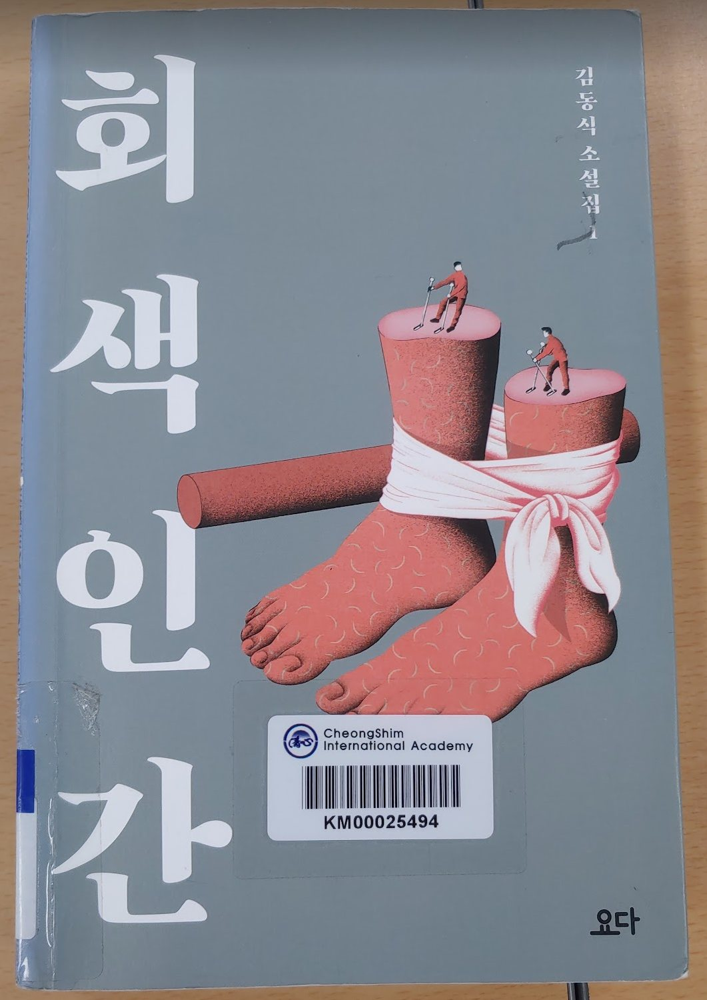

오랜만에 읽는 단편집

<b>회색 인간</b>

세상이 그 끝이 보이지 않는 심연으로 빠져들어갈 때는 미친 인간하나가 끌어내는 사람들의 기억이 모든 걸 바꾼다.

<b>무인도의 부자 노인</b>

무인도의 사면초가 상황에서 정말 속세의 돈이 계산에 들어간다는 말인가?

<b>낮인간, 밤인간</b>

갈라치기란 얼마나 역겨운 것인가. 모든 것은 조화로 이루어진다고 했거늘..

<b>아웃팅</b>

남의 결함을 찾아 나서는 데에 눈이 충혈된 그대들에게 바치는 시

<b>신의 소원</b>

하나의 소원을 위한 첫 폭력이 감행되는 순간 인류는 멸망했다.

<b>손가락이 여섯 개인 신인류</b>

차별이 가지는 자연적이고 본능적인 가치를 애써 은폐하려 하는 그 모습이 안타깝다.  

<b>디지털 고려장</b>

가두어 놓았던 기억을 꺼내 흐르게 할 때 비로소 그 기억은 빛을 발한다.

<b>소녀와 소년, 누구를 선택해야 하는가?</b>

알고 싶은 건 많아도 알 수 있는 건 적다.

[+아이유-안경](../88/)

<b>운석의 주인</b>

두둥! Plot Twist!

<b>보물은 쓸 줄 아는 사람에게 주어저야 한다</b>

과유불급 지나친 것은 미치지 못한 것과 같다는 뜻.

<b>돈독 오른 예언가</b>

제발! 봉사하는 이들에게 감사한 마음을 가져라.

<b>인간 재활용</b>

돈은 굉장한 힘을 지닌다. 착각에 빠진다. 자연의 시계를 멈출 수 있으리라 생각하는 건 오만이다.

<b>식인 빌딩</b>

제2롯데월드가 허리를 앞뒤양옆으로 꺾으며 석촌호수 물을 빨아들이는 걸 생각해 봐라.

<b>사망 공동체</b>

오래 사는 인생에 얼마나 가치를 부여해야 하는가.

<b>어디까지 인간으로 볼 것인가</b>

굴러간다\~

<b>흐르는 물이 되어</b>

바뀌면 바뀌는 대로 크게 변화하지 않는 삶이 좋다.

<b>영원히 늙지 않는 인간들</b>

멋진 할아버지가 되어 손주들에게 무용담을 들려주고 싶다.

<b>공 박사의 좀비 바이러스</b>

흐르는 물이 되어 2

<b>협곡에서의 식인</b>

뛰어난 전략전술로 빚어낸 빅토리

<b>어린 왕자의 별</b>

김동식 작가는 개미 젤리 사육장을 보고 느낀 게 많았나 보다.

<b>444번 채널의 동굴인들</b>

분파를 나눠 서로를 먹어치우는 것과 모두 협력해 다 함께 말라죽는 것의 차이가 뭘까

<b>지옥으로 간 사이비 교주</b>

조건이 너무 좋을 때는 사기당하고 있는 게 아닌지 되돌아봐라.

<b>스크류지의 뱀파이어 가게</b>

크으윽 반격이다!

<b>피노키오의 꿈</b>

피노키오는 정말 나무가 되고 싶었을까? 물론이지!
