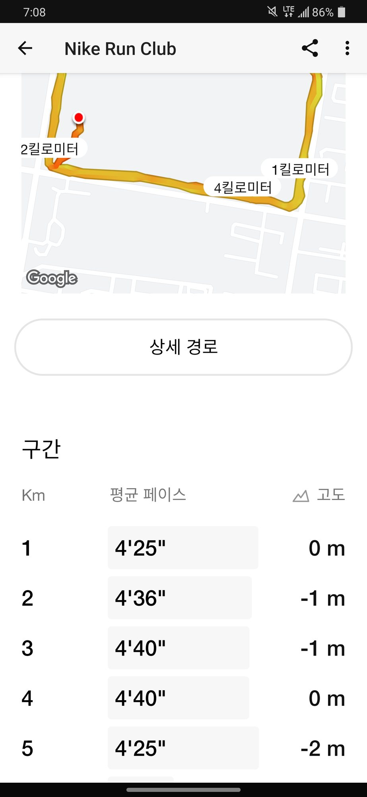

9월 28일 첫 5km 기록 측정을 해보았다. 어제 자전거 82km 타고 오늘 15000보 걸어서 컨디션이 나쁜 느낌이었다.

스트라바를 쓰려다 5km 목표 달리기 때문에 NRC로 급하게 바꿨는데 진짜 오류 많고 별로더라 스트라바 다시 써야지.

전체적으로 운동하는데 도움 받고 싶어서 스마트워치를 하나 살까 하고 많이 찾아봤다. 가민 포러너 55랑 코로스 페이스 2 중에 굉장히 고민하다가 코로스 페이스 3가 곧 국내 정발할 것 같아서 그때까지 기다리려고 한다. 5km 22분 46초 걸렸다.

