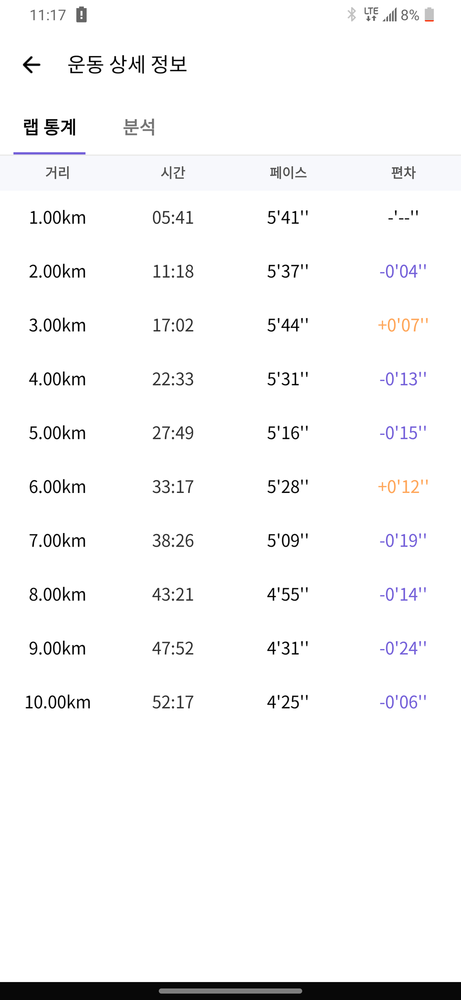

10월 1일 첫 10km 기록 측정을 해보았다. 지난 5km 측정 이후 있었던 근육통이 회복되었다는 느낌이 들어 10km 도전을 하게 되었다. 초반에는 완주에 대한 확신이 없어 보수적인 페이스로 달리기를 시작하였다. 거리가 누적됨에도 특별한 피로감이 느껴지지 않았고 조금씩 페이스를 줄여가며 10km를 완주했다. 완주 이후에는 약간의 무릎 관절 통증이 있었다. 52분을 연속으로 뛴 건 태어나서 처음인데 페이스 조절하면서 달리니 생각보다 별다른 느낌은 없다. 다음 훈련 때 10km를 더 빠르게 완주하는 것을 목표로 할지 15km를 완주하는 것을 목표로 할지 고민 중에 있다.

