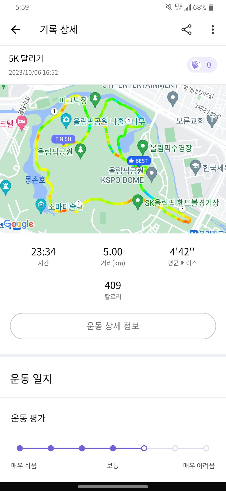

10월 6일 룸메이트의 첫 5km 기록 측정을 25분으로 마무리하는 것을 돕고자 페이서로 함께 달렸다. 초반 3km 동안은 5 min/km 아래의 페이스를 유지하는 데에 집중했다. 마지막 2km가 남은 상황에서 친구 상태를 보니 페이스를 올려도 괜찮겠다 싶어 마지막 두 구간은 4' 30'' / km로 페이스를 끌어올렸다. 5K도 끝내고 아티스틱 스위밍 훈련도 기분 좋게 마쳐서 여러모로 즐거운 운동을 한 날이다.

