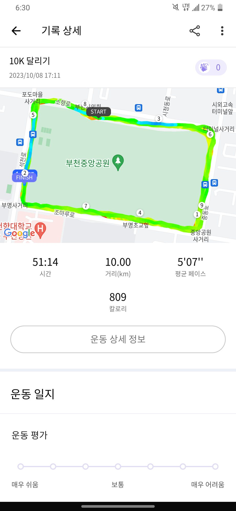

10월 8일 룸메이트와 진행하는 과학대회 준비를 마치고 공원 10km 달리기를 하였다. 룸메이트가 10km를 뛰어본 적이 없어 첫 기록측정을 한다는 것에 의의를 두고 달렸다. 마라톤에 관심을 가지고 달리기, 몰입의 즐거움을 읽게 되었는데 달리는 순간에 차분히 집중하다 보니 실제 몰입을 경험하고 긴 시간이 순식간에 지나간듯한 기분을 느꼈다. 친구도 이 몰입을 느꼈으리라 생각한다. 전체적인 달리기 동작의 시작과 끝이 매우 매끄럽게 연결되었고(seamlessly connected) 페이스를 올리려 할 때 손쉽게 몸의 템포를 높여 통통 앞으로 튀어가는 듯한 느낌을 받았다. 달리기가 계속되며 그 자세가 개선되고 있음을 확실히 느낀다. 오늘은 대회 데이터 측정(5시간) -> 바둑(2시간) -> 10km 러닝(1시간) -> 부천 다락 페스티벌 관람(30분)의 다양한 경험을 하게 된 하루여서 기억에 오래 남겠다 싶다.

