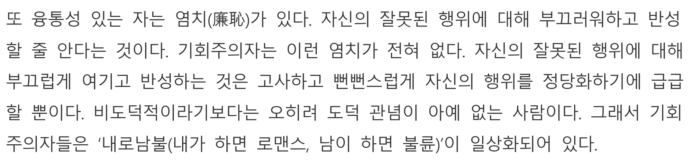

대다수의 사람들은 인생을 보내며 필연적으로 친구 관계를 맺을 무수한 기회를 가진다. 이때 유익한 관계를 맺을 수 있을지 가늠해 보기 위해서는 다양한 방면에서의 평가가 필요하다. 수많은 측면이 있지만 이 중 가장 중요한 부분은 형제애를 느낄 수 있는 사람인지이다. 친구의 성공에 최소한의 기쁨을 느끼는지 친구의 성공을 진심을 다해 응원해 줄 수 있는 사람인지가 절대적으로 중요하다. 18년의 짧은 경험에도 이 차이를 극명히 관찰할 수 있는 기회가 있었다. 친구가 이목의 집중을 받는 것을 응원하기는커녕 보고 있는 것조차 힘들어하는 사람이 있다. 자신이 말하는 내용에 아무도 대답해주지 않을 때 누군가가 이에 관심을 줄 때까지 계속 같은 말을 반복하는 모습이 앵무새와 다를 바가 없다. 이러한 사람을 계몽하려 하지 마라.

*횡성 희망신문 - 조만희*
