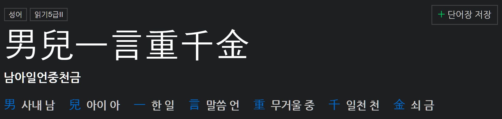

아름답게 포장되어 있던 과거의 기억들을 열어 들여다보는 순간 그 시절의 철없고 나밖에 모르던 내 모습이 눈에 들어온다. 나 스스로가 자초해 낸 과거는 바꿀 수 없을뿐더러 내가 직접 만들어낸 일이라는 사실이 상황을 더욱 끔찍하게 만든다. 혼자만이 고통받고 끝났던 일이 훨씬 단순하다. 만약 고통스러운 기억이 사랑하던 사람과 관련이 될 때면 사방에서 검은 판자가 나의 주변을 조여 오는 것만 같다. 이러한 맥락이 나 스스로 편한 환경에 있기를 거부하게 한다. 편한 환경에 있을수록 현재가 아닌 과거의 나를 되돌아보기 때문이다.

다시 한번 말하자면 아픈 기억들은 주로 정원사의 놀라운 재단 아래에 아름다운 모습을 하여 나를 기다리고 있지만 추억에 더욱 빠져들고자 과거를 분해하는 과정을 거듭할수록 눈뜨고 지켜볼 수 없는 나의 과오들을 마주하게 된다. 일련의 과정은 나에게 결코 가볍지 않은 상처를 남긴다. 이러한 이유로 나는 나 자신을 한계에 몰아붙이는 상황에서 편안함을 찾는다.

한 줄로 줄이자면 후회스러운 말들을 남긴 기억이 아프다.

