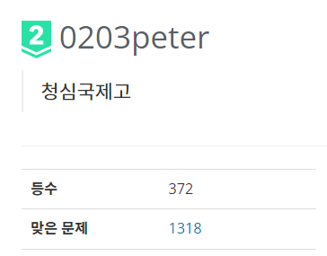
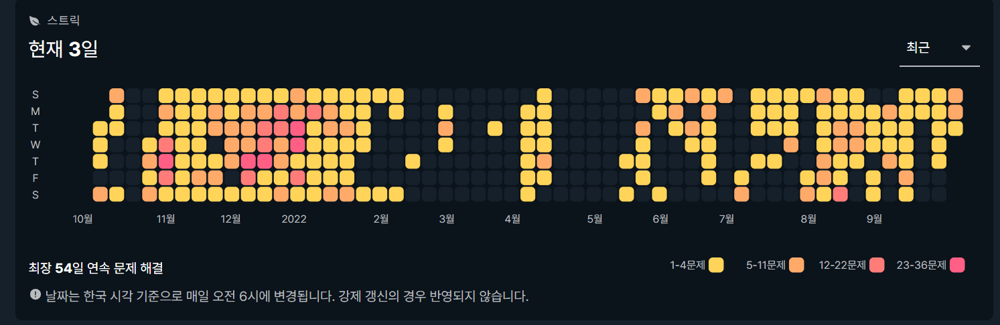

최근 맞은 문제 1300문제를 넘기게 되어 이 글을 통해 나의 현 상황과 감상을 기록해보려고 한다.

*3월~4월 SAT 준비, 5월 부근 AP, 이후 KOI, NYPC 예선탈락, Meta HackerCup Round 1 탈락*

알고리즘 문제 해결을 시작한 지 벌써 1년 반이 다 되어간다. 지난 시간 동안 계속해 느낀 거는 알고리즘 계속 열심히 공부하면 잘해지기는 할까?라는 생각이었다. 두 번의 KOI 예선 탈락, 두 번의 NYPC 예선 탈락, PS를 시작한 이후로 가장 기억에 남는 일들이다.. 지난 시간 동안 청심국제중학교에서 청심국제고등학교로 진학하고 SAT, AP와 처음 고등학생이 되어 생활하게 된다는 다른 여러 가지 이유들로 나름의 정체기를 맞이하기도 하고 얼마 전부터는 성장하는 방법에 대한 감을 찾은 것 같다가도 다시 내가 알고리즘을 잘하게 되려면 무엇을 어떻게 해야 할지 감이 안 잡히기도 한다. 내가 느낀 가장 핵심적인 생각은 "나는 바보다."이다. 모두 기존에 보았던 문제, 알고 있던 방법에서 말만 조금 바뀌거나 약간의 변형 이외에는 차이점이 없는 문제에도 머리를 싸매며 어려움을 겪을 때가 많다. 막힘 없이 코드를 써 내려가는 경우도 드물고 구현 중에도 계속해 원래의 계획에 차질이 생기는 경우가 대부분이다. 이러한 문제를 해결하기 위해 어떻게 학습해야 할지 수차례 고민하였다.

고민의 결과는 이러하다. 실력 향상을 위해서는 문제를 풀고 난 이후가 더욱 중요하다. 문제를 풀며 내가 시간을 낭비한 부분은 언제인지, 무엇이 부족해서 그 시간을 낭비한 것인지, 왜 아이디어를 바로 떠올릴 수 없었는지 하나 하나 되짚어보며 내가 부족했던 부분을 재고하고 개선점을 생각하는 것이 앞으로의 성장에서의 핵심이라는 생각이 들었다.

이런저런 생각을 하게 되던 요즘 내가 재학중인 청심국제고등학교에서 GLTC HABIT MAKERS라고 하는 프로젝트를 진행하게 되어 참여하게 되었다. 대략적인 내용은 습관을 하나 정하고 해당 정한 습관을 매일매일 실천하며 팀원들과 성과를 공유하는 것이다. 이번 기회를 통해 매일 한 문제씩은 내가 문제를 접근했던 방법이랑 푸는 데 걸린 시간, 감상 등을 기록하게 될 예정이다.

이러한 계획을 통해 성장하게 될 내가 너무나도 기대되어 당장 내일부터 이 기록을 시작하려고 한다.

할수있다!
