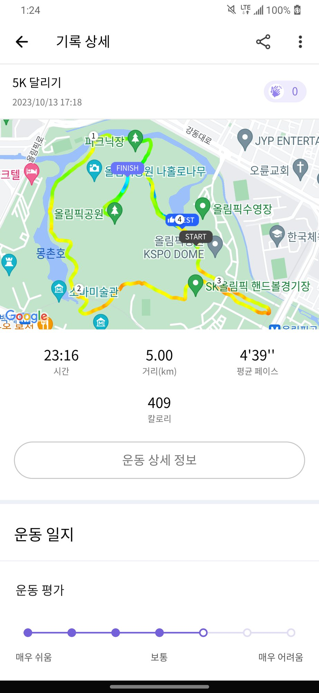

10월 13일 아티스틱 스위밍 훈련 전에 올림픽공원 5km 달리기를 룸메이트와 함께 하였다. 20분 아래로 완주하는 것을 목표로 이번 5km를 달리게 되었다. 1km 스플릿은 (3'53'' - 4'47'' - 5'10'' - 5'08'' - 4'18'')로 첫 1km 이후 힘을 잃어 기존의 목표에 미치지 못하는 기록을 얻게 되었다. 그럼에도 불구하고 초반 1km를 빠르게 뛰고 난 후 페이스를 망친 상태로 달리기를 마무리하는 경험을 하게 된 점에 있어서 이번 달리기는 수확이 크다고 생각한다. 짚고 넘어가면 좋을 부분은 처음 1km 이후 정신적으로 약해져 2\~4km 구간을 나의 능력치보다 느리게 뛴듯한 느낌이 있다. 심지어 마지막 300m는 정말 스프린트를 했다고 할 수 있을 정도의 달리기 폼이 나왔다. 다음부터는 전체적으로 나의 힘을 고르게 사용하는 데에 더 집중해도 좋을 것 같다. 나의 풀코스 계획을 더욱 상세하게 이야기해 보자면 올해 11월 19일에 열리는 부천 복사골 마라톤대회 10km를 완주하고 서울 동아 마라톤 신청 자격을 취득하여 내년 3월 즈음 열리는 서울 동아 마라톤 대회에서 풀코스를 뛰고자 한다.

