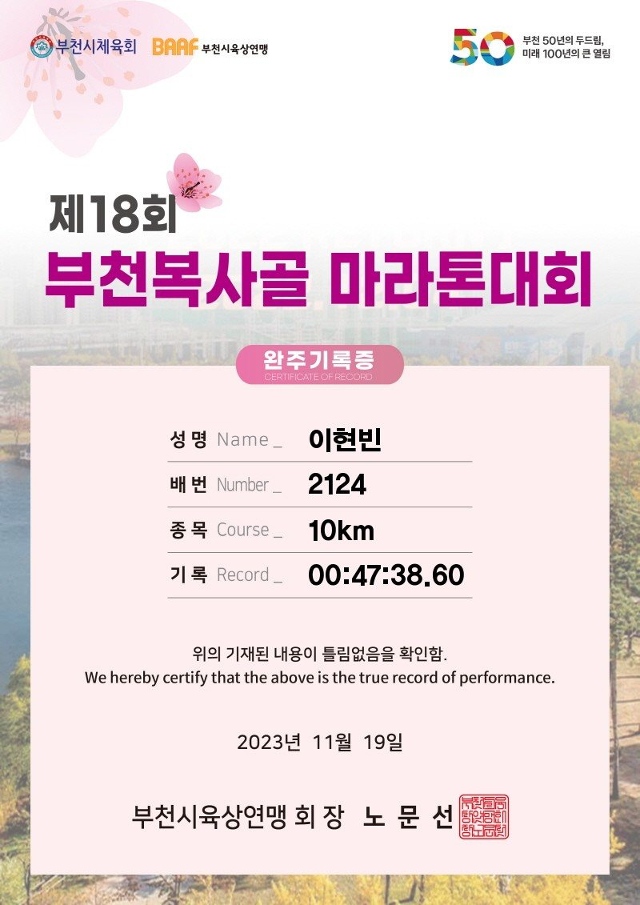
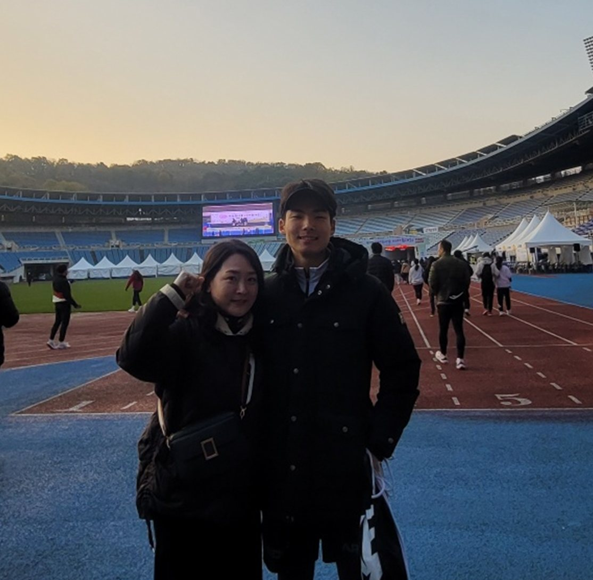
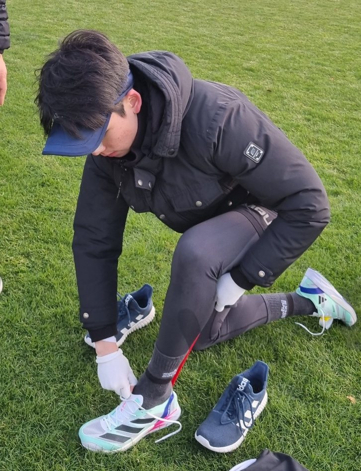

-   <b>이름:</b> 부천복사골마라톤
-   <b>날짜:</b> 2023\. 11. 19.
-   <b>거리:</b> 10km
-   <b>장소:</b> 대한민국, 부천시
-   <b>웹사이트:</b> [https://bskrun.co.kr/](https://bskrun.co.kr/)
-   <b>시간:</b> 47:38 

<table>
<tr><td>목표</td><td>설명</td><td>성공?</td></tr>
<tr><td>A</td><td>걷지 않고 완주</td><td>성공</td></tr>
<tr><td>B</td><td>50:00 아래</td><td>성공</td></tr>
<tr><td>C</td><td>48:00 아래</td><td>성공</td></tr>
<tr><td>D</td><td>남성 부문 상위 10%</td><td>성공</td></tr>
</table>

#### Pre-race 경주 전

어렸을 때 부모님과 함께 4.21km 마라톤에서 달린 이후로 마라톤에 참가해 본 적이 없어서 마라톤에 어떤 걸 준비해야 할지 막막했다. 3일 전 정도부터 카브로딩을 하겠다는 생각으로 전체적인 탄수화물 양을 늘렸다. 이때 정제당도 함께 더 먹게 되었는데 이건 실수 같다.

마라톤 당일이 되어서는 5시 50분에 일어나 엄마가 해주신 누룽지를 먹었다. 다 먹고 나서 한 시간 정도는 내가 좋아하는 음악을 들으며 부천 도로를 달리는 모습을 계속해 상상했다. 7시 40분이 되었고 부모님과 함께 부천종합운동장으로 차를 타고 갔다. 8시에 운동장에 도착해 이곳저곳 둘러보고 화장실을 다녀왔다. 이후 조깅 400m, 대회페이스 100m x 2 정도로 몸을 풀었고 함께 출전하기로 한 민준이를 만났다. 8시 20분이 되었고 포도당 캔디를 하나 먹었다. 민준이와 함께 400m 정도를 더 조깅하며 체온을 유지했다. 화장실을 한 번 더 갔는데 줄을 10분 정도 기다렸다. 8시 45분이 되었고 포도당 캔디를 하나 더 먹으며 부천의 정치인들이 나와서 인사하는 모습을 보았다. 8시 55분이 되었고 출발선 앞에 섰다.

#### Race 경주 중

9시가 되었고 사회자의 3, 2, 1 카운트와 함께 마라톤이 시작되었다. 출발 총성과 함께 사람들과 달려 나가기 시작했다.

운 좋게 출발선의 30m 정도 앞에 서서 초반 병목 현상을 피할 수 있었다. 400m 정도 뛰었을 시점 경기장을 빠져나가며 사람들이 점점 속도를 올리는 것을 느낄 수 있었다. 내가 쫓아갈 수 있는 페이스는 아닌 것 같아서 2일 전에 뛰었던 4:48/km 페이스를 기억하며 사람들을 먼저 보내주었다. 이때 민준이가 군중의 속도에 맞추어 점점 멀어지는 것을 보고 굉장하다 느꼈다. 5\~6km 지점에서 다시 만나겠지 생각했다. 1.5km 정도 달릴 때 몸이 뜨거워짐을 느꼈고 우비를 접어 길가에 놓아두었다. 3km 지점에서 첫 급수대를 보았고 물로 입만 살짝 적셨다. 5km 지점에서 횡경막에서 쥐 날 것 같다는 느낌이 조금씩 들어서 페이스를 조금 낮췄다. 원래는 이때 포도당 캔디를 하나 더 먹을 계획이었는데 달리다보니 까먹었다. 7km까지 갔는데도 민준이가 보이지 않아 초조한 느낌이 들었다. 8km 표시를 보고 한 번 속도를 확 높였다가 다시 속도가 서서히 줄어들었다. 이때 높인 속도를 유지하지 못해 52\~54분 정도로 마무리하겠다고 예상했다. 9.5km 정도 왔을 때 부천종합운동장이 눈에 들어오기 시작했고 결승 지점이 눈앞이라는 생각에 질주하기 시작했다. 마지막 40초 정도의 시간 동안 약 50명 정도를 제치며 결승 지점을 통과했다. 결승점을 100m 앞에 두어 질주하며 계시기의 47분 표시를 보며 놀라운 정도의 흥분상태를 느낄 수 있었다.

#### Post-race 경주 후

끝나자마자 들었던 생각은 "47분대라니! 내가 47분대라니!!"와 "김민준이 나보다 잘 달렸다고? 46분대?"였다. 끝나고 민준이를 만나서 들어보니 3km 지점에서 내가 자신을 추월하는 모습을 봤다고 한다. 오히려 끝까지 민준이에게 뒤처지고 있다는 생각이 47분대를 만들어낸 것 같다. 2일 전에 마지막으로 뛰었던 5km를 24분 9초로 마무리해서 48분은 어렵지 않을까 걱정했는데 구상했던 모든 목표를 달성할 수 있어서 너무 기뻤다. 엄마아빠 감사합니다! 경찰분들 감사합니다! 자원봉사자분들 감사합니다!

