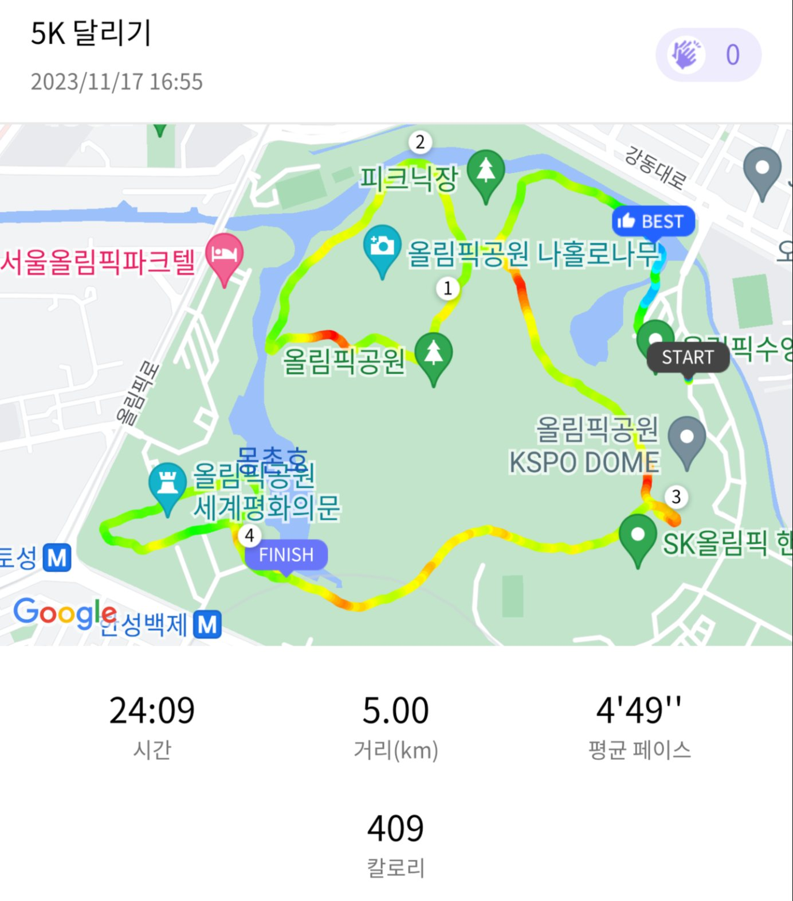

11월 17일 부천복사골마라톤대회를 2일 앞두고 5km 훈련을 진행하였다 온도는 0도 정도 되었던 것 같다. 3\~4주간 심한 감기로 고생을 조금 해서 컨디션이 안 좋았다. 짧고 가파른 업힐 두 개 정도 있었던 러닝이었다. 오랜만에 해서 그런지 정말 시간 안 가더라. 결국 5km를 24분으로 완주하며 역대급으로 느린 기록을 뽑아냈다. 날씨가 추우니 러닝 하며 코피가 꽤 나더라. 부천복사골마라톤대회 훌륭하게 끝내고 싶다.

