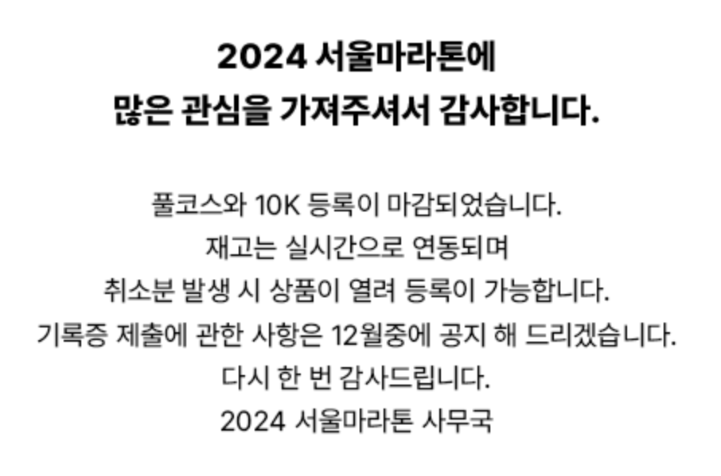

*그러지 마라 ㅠㅠㅠ 나도 껴줘*

&nbsp;오늘 간식시간에 학교 헬스장에 있는 러닝머신에서 인클라인 6, 속도 14 km/hr로 5km 달렸다. 어제 뛴 10km 마라톤의 여파가 생각보다 크지 않아 그냥 달렸다. 14km/hr가 min/km로 따지면 4분 17초인데 전혀 그런 느낌이 아니었다. 대부분의 경우 러닝머신이 실제 달리는 것보다 훨씬 쉽게 느껴진다는 것을 절실히 체감한 하루이다. 앞으로 가능한 이틀에 한 번은 간식시간에 이렇게 뛰어보고자 한다. 내년 3월에 있는 동아마라톤을 풀코스를 참가하고 싶었는데 어느새 마감되었다. 기록증은 나중에 제출해도 미리 신청 가능한 구조이던데 그것도 모르고 기록증 나올 때까지 기다리다 결국 놓쳤다. 굉장히 슬프지만 어쩔 수 없다. 내년 봄에 어떤 풀코스 마라톤을 나가는 게 좋을지 고민이다. 뭐 좋은 거 아는 사람 있으면 추천해 줘라.
