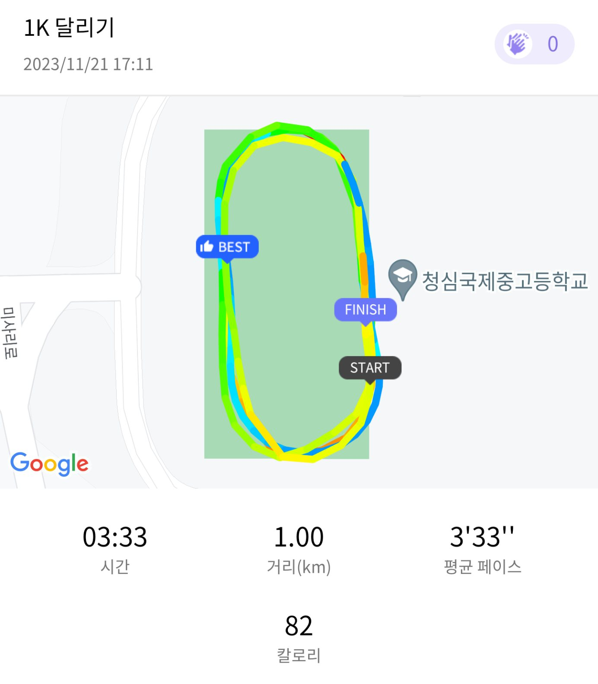

2023년 11월 21일 저녁시간에 헬스를 안 하고 운동장에 나와서 뛰었다. 원래 이두 할 생각이었는데 점심시간에 벤트오버레터럴레이즈하다 허리가 나가서 저항운동할 엄두가 안 났다. 날씨는 조금 춥지만 1km PB를 세워보고 싶어서 뛰어보았다. 3분 33초로 마무리하였다. 진짜 말도 안 된다. 날씨가 추워서 목에서 피맛이 조금 느껴졌다. 올해 남은 기간 동안 야외에서 거친 호흡은 삼가겠다. 오히려 풀마향 소재를 만들고 싶어서 달리기를 하는 느낌도 있다. 어쨌든 내년 4월에는 서울 하프 마라톤 한 번 나가고 5\~6월 즈음에 풀마라톤 하나 나갈 계획이다. 다들 힘내라 응원하는 사람들이 많다.
