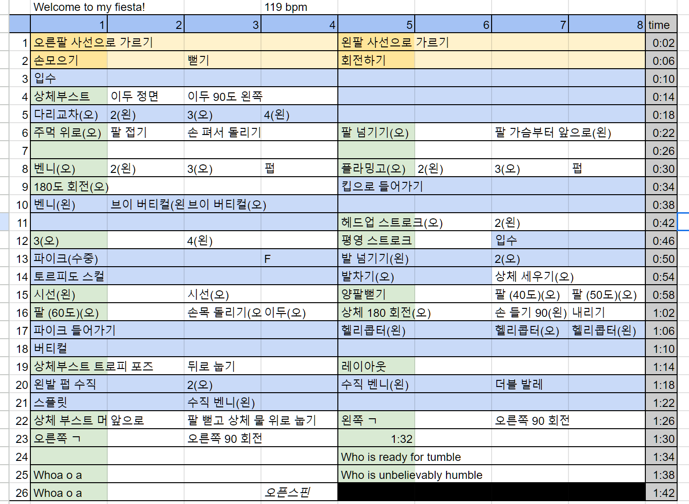

네이버블로그를 몇 개 읽었다. 일기 같은 분위기로 적는 편이 많은 것 같다. 아무래도 티스토리는 조금 더 딱딱 떨어지는 정보전달의 느낌이 있고 네이버블로그는 이웃들과 일상을 공유하는 따뜻한 플랫폼의 느낌이 있다. 그런 일기 같은 글들을 읽다 보니 나도 그런 식의 일기를 남기고 싶다는 생각이 들어 기록한다.

2일 전에 벤트오버레터럴레이즈를 하는데 허리가 나간 것 같다. 생각 없이 막 휘젓고 난 후 헬스장을 나오며 섬칫함을 느꼈다. 이건 아니다 싶었고 아직까지 허리가 아프다. 빨리 낫고 싶어 정선근의 척추위생을 공부 중이다. 잘 모르겠다.

어제는 학교 습관형성 프로젝트 중간포상으로 인해 헤븐지 버거에서 회식을 했다. 운영진으로서 함께 가게 되었는데 지금까지 인증을 놓치지 않고 진행하며 습관을 이어온 참가자들이 새삼 대단하다고 느껴졌다. 작년에는 나도 매일 알고리즘 문제풀이 열심히 했는데 언제 이렇게 다 놓아버린 거지 싶다. 그냥 미칠 것 같다. 19900원의 스페셜 돈카츠 세트를 먹었는데 확실히 별로였다. 돈카츠가 이렇게 애매한 맛일 수 있을까 싶었다.

*일단은 이렇게 정리했는데 또 바뀔지도 모르겠다*

다음 주 토요일에 아티스틱 스위밍 대회가 있다. 이번에는 솔로, 듀엣, 팀 세 부문 모두 출전한다. 오랜 기간 준비하기도 했고 친구들과의 경쟁도 포함되어 있어 여간 설레는 일이 아니다. 이렇게 중요한 시기에 허리를 다치다니 참 후회스럽다.

요즘 학교 헬스 동아리의 인스타그램 계정을 운영하고 있다. 릴스 올리는 것도 재밌고 스토리 이것저것 찍어서 누가 읽었는지 확인하는 맛이 있다.

지난 일요일 10km 단축 마라톤을 성공적으로 마치고 다음 마라톤으로 무엇을 출전해야 할지 고민 중에 있다. 서울동아마라톤에 출전하면 모든 계획이 맞아떨어졌겠지만 유감스럽게도 신청이 마감되었다. 남은 후보군은 서울하프마라톤, 경기마라톤, 인천하프마라톤 정도가 있다. 5월 첫째 주에 있는 AP 때문에 서울하프마라톤은 현실적으로 어려울 것 같고 남은 두 개 중에 고민이 많다.

요즘에는 스윙스가 참 대단하다고 느낀다. 사건사고 많았지만 결국 이루어낸 것 같다. 각자 사는 인생이고 최선을 다하는 것보다 나은 길은 없다.

원래 이런 식으로 일기를 적을 때에는 사진을 이것저것 첨부해 읽는 재미를 줘야 하는데 작성하며 보니 사진 찍은 게 없다. 다들 읽어줘서 고맙다. 재밌게 읽었으면 댓글도 남겨줘라.
