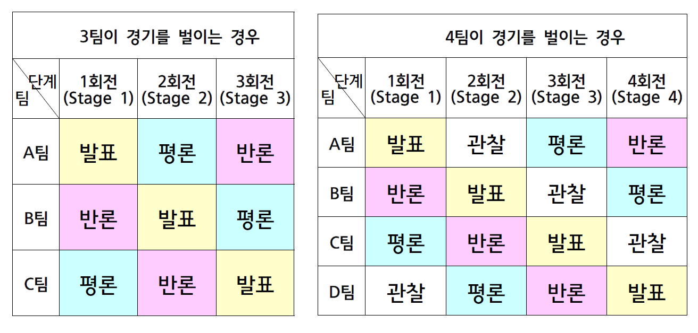
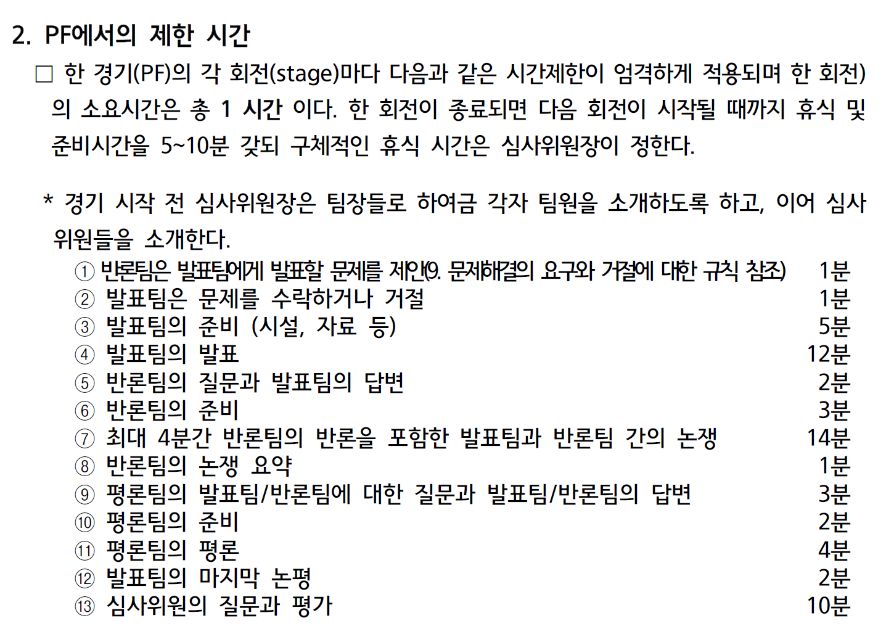
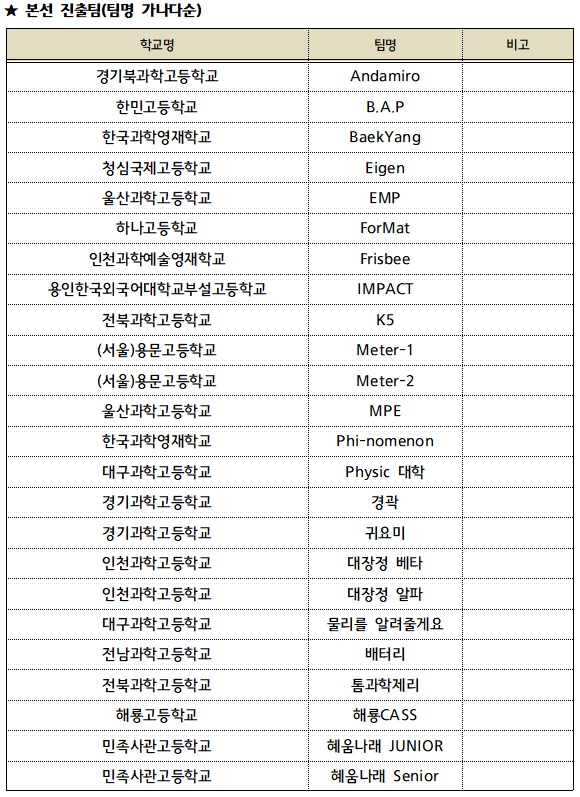
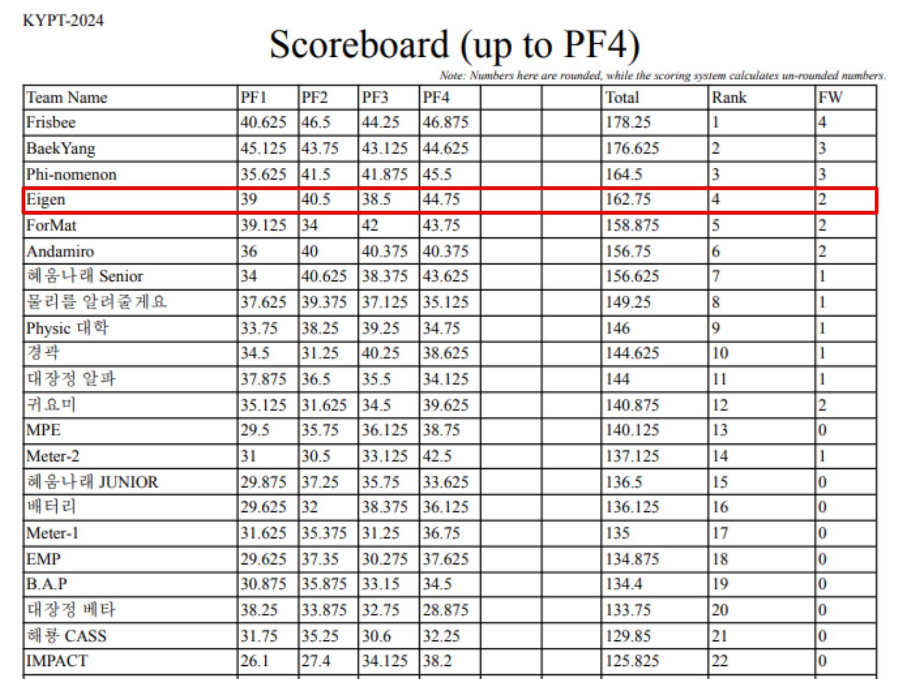
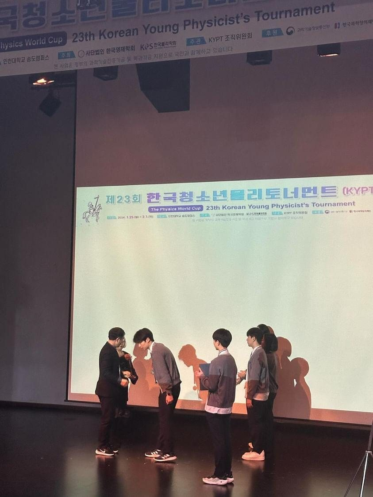

KYPT를 잘 모르는 사람들의 이해를 돕기 위해 간단한 설명을 보이겠다.

<b>1\. 경기의 구성</b>

○ 3\~4개의 팀이 하나의 물리토론경기(PF)의 단위를 이룬다.  
○ 본선전은 모두 4번의 경기(PF)로 구성되며, 각 경기(PF)는 3\~4 회전(Stage)으로 구성된다.

이 정도 알면 이해하는 데에 어려움은 없을 것이다.

### <b>예선</b>

작년 말, 2024년의 KYPT(Korean Young Physicists' Tournament)에 출전할 팀원으로 합류하게 되었다. 최종 보고서를 급하게 작성하게 된 탓에 청심제에도 참여하지 못하고 실험실에 상주하며 한 해를 시작했다. 제출 자료의 수준이 여러모로 부족한 부분이 있다고 생각해 본선 진출을 별로 기대하지 않았다. 그러던 중 KYPT 본선 합격 결과를 친구로부터 듣게 되었다. 이후 방학기간 중 2주간 학교에서 합숙하며 실험적으로 부족했던 부분을 보강했다.

### <b>본선</b>

1월 29일 월요일 참가팀 모두가 인천대학교에 모였다. 내가 멋지다고 생각하는 학교들은 정말 대부분 모인 것 같다. 우리 학교와 비슷한 결의 용인외대부고, 민사고, 하나고부터 전국 각지의 과학, 영재고까지 가히 압도되는 수준의 본선 진출팀들을 보고 수준 높은 경험을 할 수 있을 것이라는 기대감과 함께 우리 학교가 잘할 수 있을 것인가라는 걱정이 뒤섞여 머릿속을 어지럽게 했다.

1일 차

<b>PF 1</b>

한과영의 우수한 역량을 몸소 느껴 이후 PF에 도움이 정말 많이 되었다.

나는 평론을 하게 되었는데 첫 평론은 정말 무난하게 보냈다고 생각한다.

PF1이 끝난 후 4등이라는 결과가 나왔다. 15위쯤에 위치할 것이라고 생각했던 것과는 전혀 다른 결과였다.

2일 차

<b>PF 2</b>

첫 FW(Fight win)을 쌓았다.

또 평론을 하게 되었다.  심사위원의 점수는 내려갔지만 PF1에 비하여 훨씬 만족스러운 평론을 보였다고 생각한다.

한과영의 평론을 벤치마킹 한 것이 아주 좋게 작용했다.

PF2가 끝나고 3등으로 1위 올라간 결과를 받았다. PF1에서 과대평가받았다는 우려와는 정반대의 결과였다.

팀 전체적으로 굉장한 자신감이 붙었다.

<b>PF 3</b>

작년 결승 진출팀인 하나고, 인과영과 함께한 굉장히 부담됐던 PF였다.

역시 배울 점이 많았다. 특히 인과영은 순수 학문적 깊이뿐만 아니라 훌륭한 경기운영 보여줘 참 인상 깊은 PF가 되었다.

나는 단상에 나와 발표하지는 않았다.

PF3가 끝나고 4등으로 1위 내려간 결과를 받았다. PF3에서 순위가 대폭 하락할 것을 우려했지만 그렇지 않아 안도했다.

3일 차

<b>PF 4</b>

두 번째 FW(Fight win)을 쌓았다.

마지막인 만큼 우리가 준비한 모든 것을 보이고 싶었다. 승헌이가 50점(발표, 반론), 내가 또또 10점(평론)을 담당하게 되었다.

발표를 들으며 평론 발표자료를 만드는 데에 PPT 이슈가 생겨 그저 그런 평론을 한 것 같아 아쉬움이 있었다.

그렇지만 승헌이가 50점을 매우 훌륭하게 견인해 주어 아주 만족스러운 마지막 PF가 되었다.

PF4가 끝나고 4등으로 순위를 유지하며 대회를 마무리했다. 그동안의 우리의 평균점수가 39.3점이었던 것에 대비해 44.75점의 굉장한 점수를 받았지만 Phi-nomenon 역시 훌륭한 대회 마무리를 성공시키며 순위를 굳혔다. 1\~3위까지 결승전에 진출함과 동시에 금상을 수상하는 상황이라 굉장히 아쉬운 감정이 들었다.

### <b>감상</b>

이번 대회를 통해 정말 값진 경험을 했다. 전혀 희망을 찾을 수 없었던 상황에서 시작해 한순간 한순간 열심히 하다 보니 결승 진출을 다투는 팀이 되어있었다. 무언가를 목표할 때 그 목표를 실제로 이룰 수 있는지는 별로 중요하지 않은 것 같다. 목표의 달성 가능성보다도 그 목표를 위해 최선의 노력을 할 수 있는지가 중요하다. 최선을 다한 경험은 목표의 달성 여부와 관계없이 대체 불가능한 매우 값진 자산이 된다.

### <b>추신</b>

KYPT도 과학 올림피아드의 분류에 포함된다. 중학교 2학년이었을 때부터 다른 과학 올림피아드인 정보 올림피아드를 잘하고 싶어 굉장한 시간을 쏟았는데 2023 한국정올 본선에 출전해 동상을 수상한 것이 나의 최고 성적이었다. 이에 상대적으로 굉장히 적은 시간을 노력한 KYPT에서 은상을 받아버리니 심정이 복잡하다. 또 IMPACT 팀에는 용인외대부고에서 국제 대학을 준비하는 친구도 있었다. 국제대학을 준비하는 친구를 청심 밖에서 거의 볼 일이 없는데 이렇게 보니 참 반갑게 느껴졌다. 전혀 예상치 못했던 훌륭한 결과와 소중한 인연을 얻어갈 수 있어 참 좋은 시간이 되었다.

끝!

