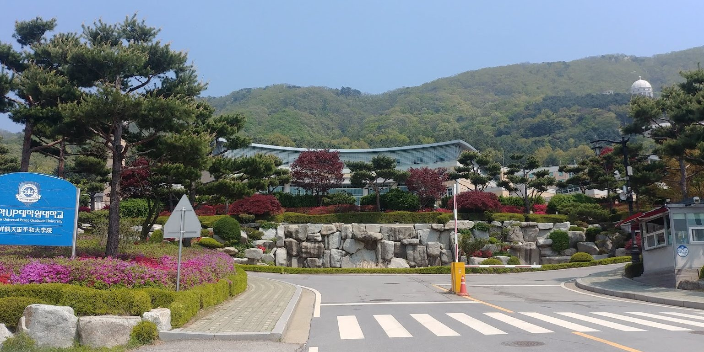
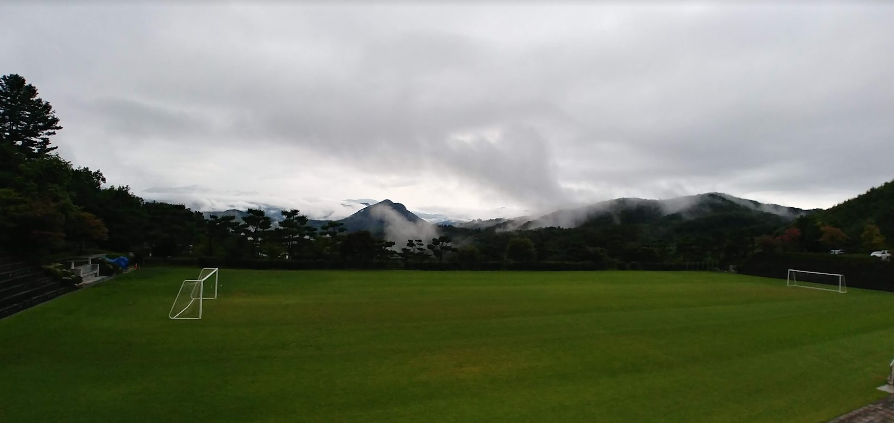
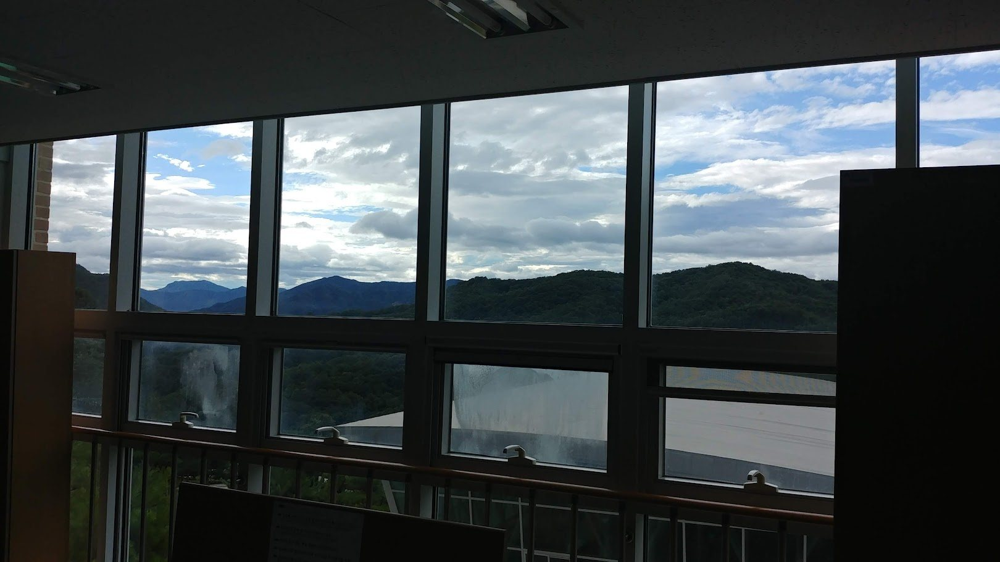
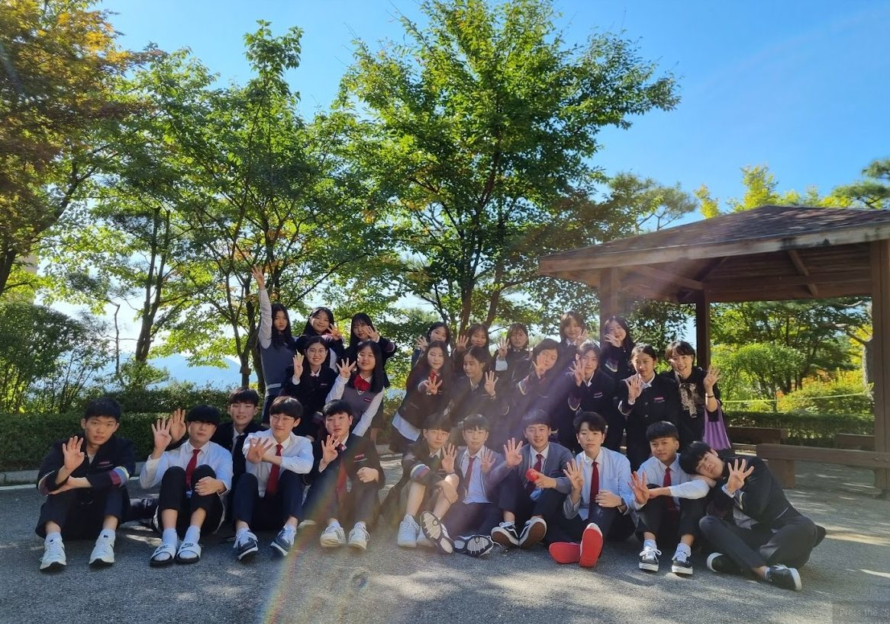
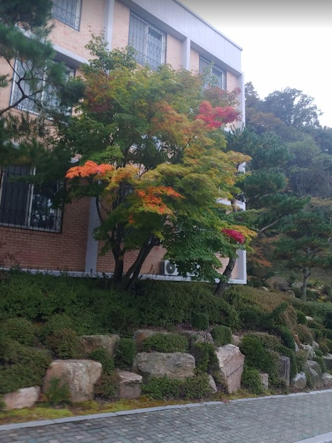
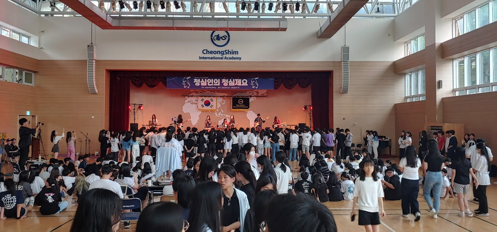

청심의 여름은 언제나 아름답다.

청심에서의 여름, 단 한번 남았다.

복잡 미묘한 감정이 든다.

2019년의 여름, 안개가 자욱하다. 아무것도 몰라도 아는 척 좀 해본다.

2020년의 여름, 저 창 너머에는 뭐가 있는 걸까 기대된다. 새로운 관계와 즐거움도 선택의 후회와 좌절도 함께한다.

2021년의 여름, 해가 따뜻했다. 그저 아름답게 보낸 나날들 무지개가 순간을 수놓았다.

2022년 여름, 잊을 수 없는 경험들, 정열의 폭풍에 휩쓸려 길을 잃었다.

2023년의 여름, 인고의 시간, 성장의 시간.

이런 풍경도 마지막이다.

이천이십사년 만을 남겨두고 그저 설렐 뿐이다.
