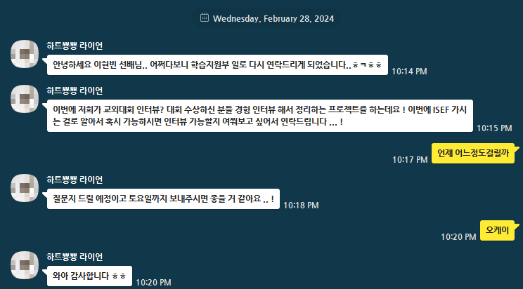

어쩌다보니 ISEF Finalist라는 이름으로 인터뷰를 하게 되었다. 답변하다보니 열심히하게되어서 이렇게 기록을 남긴다.

Q1. 안녕하세요, 학습지원부 입니다 :) 자기 소개와 2023년에 진행하셨던 실험에 대한 간단한 설명 부탁드릴게요 !

A1. 안녕하세요, 컴퓨터과학 좋아하는 이현빈입니다. 2023년에 진행한 실험은 거미의 비행실을 모방한 열대저기압측정기구 spidersonde에 대한 공학 연구였습니다. 

Q2. 평소에 관심 가지고 계셨던 분야가 있으셨다면 ..!

A2. 평소 물리학, 컴퓨터과학에 관심이 많습니다.

Q3. 주제를 선정하게 된 계기가 무엇인가요 ?

A3. 열대저기압의 예측에 대한 선행연구를 조사했을 때 기존 솔루션에 문제가 있다는 것을 확인했고 이를 거미의 비행실을 모방해 참신하게 해결할 수 있으리라 전망해 주제를 선정하였습니다.

Q4. 실험 기간과 과정에 대해 자유롭게 설명해주시면 감사하겠습니다.

A4. 실험 기간은 약 9개월로, 우선적으로 거미의 비행실을 모방한 spidersonde를 구성할 때 최적의 비행실의 길이와 개수에 대한 연구를 진행했습니다. 이후에는 풍동, 낙하 등 환경에서 데이터를 측정하고 분석해 결론을 도출했습니다. 여름방학부터 11월경까지 가장 바쁘게 진행했습니다.

Q5. 진행 과정에서 어려움이 있었다면 ?

A5. 실험 계획을 미리미리 짜서 끝에 급하게 마무리하는 상황을 피하고자 노력했지만 그 계획이 밀리고 밀려서 결국 급하게 마무리하게 된 점이 후회스럽습니다. 실험 계획이 잘 지켜지고있는지 정확하게 피드백하는 정기회의가 있었으면 더 좋았을 것 같습니다.

Q6. 학교 차원에서 더 지원해줬으면 하는 부분이 있으시다면 ? (이건 인터뷰에 들어가지는 않고 2024 학습지원부에서 진행하게 될 학생 실험 지원 프로젝트에 반영하고 싶어서 여쭤봅니다 \~!)

A6. 실험물품 보관 장소를 마땅히 할 만한 곳이 없는 점이 아쉽습니다.

Q7. 과학 실험 대회 관련 팁 부탁드릴게요 !

A7. 과학 실험 대회를 준비할 때는 본인이 하는 연구가 왜 필요한지, 결과가 어떤 의미를 가지는지에 대한 상세한 근거가 있어야합니다.

Q8. 대회 질의응답 팁이 있으시다면 !

A8. 대부분의 발표에서는 심사위원분들이 본인의 연구내용을 자세히 이해하기 어렵습니다. 연구의 지엽적인 결함에 집중하기보다는 연구의 흐름이 자연스러운지, 연구에 포함시킨 내용이 꼭 필요한건지 검토하는 것을 우선시해야합니다.

Q9. 선행 연구 찾는 팁이 있으시다면 !

A9. Google scholar에 키워드 중심으로 검색합니다. 논문으로 등록되었다고 너무 다 사용하지 말고 선행연구에서 주장하는 내용이 이해가 되고 납득이 되는지 생각하는 것도 중요합니다.

Q10. 스팀/한화/ysc/ksef/isef 중에 나가신 대회가 있으시다면 각 대회별 특징이나 팁 부탁드릴게요 !

A10. STEAM R&E (22년 교육부장관상) (23년 교육부장관상), KSEF (22년 동상) (23년 은상). 

STEAM R&E 특징 : 제출한 논문은 거의 안보는 느낌이다. 호소력 있는 발표가 중요한 것 같다.

KSEF 특징 : 발표장소가 너무 멀다

스팀과 KSEF 모두 심사위원이 연구를 이해하기 좋게 전달하는 것이 중요합니다. 그리고 연구내용을 들었을때 “이걸 왜했지?” 보다는 “이래서 이걸 해야하는구나” 라는 생각이 들 수 있도록 설명해야합니다.

Q11. 추가로 하고 싶은 말이 있으시다면

A11.  바둑에서 명국의 기보를 두어보며 남들이 어떻게 했는지 배우려는 자세는 중요합니다. 하지만 이것이 본인의 대국을 복기하는 것보다 우선시되면 안됩니다. 본인의 경험을 돌아보며 스스로를 보강하는 것 만큼 훌륭한 배움은 드뭅니다.

이창호 九단의 자서전에서 인상깊게 읽은 구절을 발췌하며 인터뷰를 마무리하고싶습니다.

 <b>승리한 대국의 복기는 “이기는 습관”을 만들어주고 패배한 대국의 복기는 “이기는 준비”를 만들어준다.</b>

 -이창호의 부득탐승-
