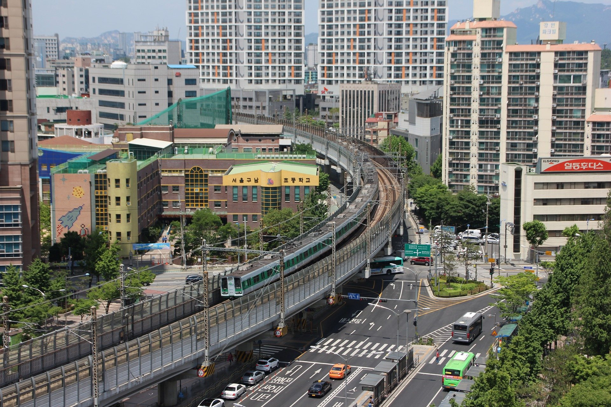

다시는 되돌아갈 수 없는 초등학생 시절이 그립다.

1\. 영어시간에 ppt로 게임하고 damla 주셨던 것  
2\. 학급 준비물실에 가서 이름 적고 물건 가져오던 것  
3\. 여러 체육시간에 5층 옥상에 올라가서 피구를 하던 것  
4\. 운동장에 십자가 모양의 암벽이 있어 많이들 이용하던 것  
5\. 알뜰시장을 열어 운동장에 돗자리를 깔고 여러 사람들이 모여 즐기던 것  
6\. 과학시간에 두부를 만들어 간장과 함께 먹던 것  
7\. 이선용 선생님과 함께 모둠별로 매달 다른 음식을 준비해 와 함께 먹던 것  
8\. 선생님들께 사랑합니다로 인사한 것  

청심국제중고등학교도 몇개월 안 남았는데 분명히 그리울 거다.
