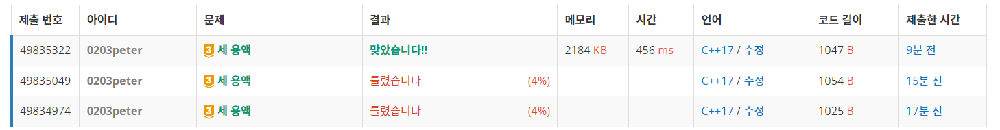

세 용액 중 두 가지 용액만 특정해주면 나머지 한 가지는 logn만에 알아서 선택된다는 사실을 이용하였다.



문제 접근 과정

처음 읽었을 때(언제였는지 잘 기억 안 남) : 알 것 같은데 어떻게 푸는지 모르겠다.

갑자기 떠오른 풀이 : n^2이 가능하니 두 개를 정해주고 하나는 알아서 정해지게 하자(n = 5000)

구현 10분정도 걸림

이분 탐색 잘못 적어줘서 두 번 WA

코드 한번 쭉 다시 읽으며 오류 잡음

수정 후 기쁨의 AC

시간 복잡도 : O(n\*n\*log(n))

소요 시간 : 측정 불가

아쉬운 점

이분 탐색을 짤 때 해당 조건문에서 m을 커지게 해야 할지 작아지게 해야 할지 일단 적고 틀리면 바꾸는 경향이 있다. 고치게 되면 좋겠다.

전체적인 감상

지난 주 쯤 이 문제를 읽고 넘어간 적이 있는데 쉬는 시간에 갑자기 해답이 떠올라 급하게 구현하고 급하게 제출한 코드이다. 구현 전반에 막힘 없이 잘 써 내려가 만족스럽다. 이분 탐색의 l = m+1, r = m-1을 완전히 반대로 적었는데 테케가 잘 나온 게 신기하다.

```cpp
/* basic setup {{{ */
#include<bits/stdc++.h>
using namespace std;
typedef long long ll;
typedef pair<int,int> pii;
typedef pair<ll,ll> pll;
#define ff first
#define ss second
#define pb push_back
#define sz(x) ((int)x.size())
#define all(x) x.begin(),x.end()
#define fast_io ios_base::sync_with_stdio(0),cin.tie(0)
const int MOD = 1e9+7;
const int INF = 0x3f3f3f3f;
const ll LINF = 4e9;
/*}}}*/
int n;
vector<ll> pr(3);
long long ans = LINF;
vector<ll> vc;

int main(){
	fast_io;
	cin>>n;
	vc.resize(n);
	for(int i=0;i<n;i++) cin>>vc[i];

	bool fg = 0;
	sort(all(vc));
	for(int i=0;i<n;i++){
		for(int j=i+1;j<n;j++){

			ll sm = vc[i] + vc[j];
			int l = 0, r = n-1;

			while(l <= r){
				int m = (l+r) >> 1;
				if(sm + vc[m] > 0) r = m - 1;
				else l = m + 1;

				if(m == i || m == j) continue;
				if(ans > abs(sm + vc[m])){
					ans = abs(sm + vc[m]); // ans가 더 작아지도록
					pr[0] = vc[i]; pr[1] = vc[j]; pr[2] = vc[m];
					fg = 1;
				}
			}
		}
	}
	assert(fg);

	sort(all(pr));
	for(ll p : pr) cout<<p<<' ';
	cout<<'\n';
}
```
