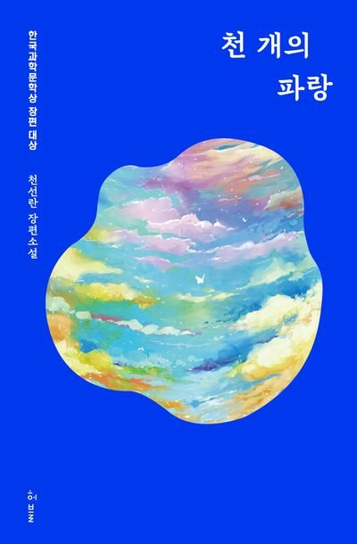

과학에 대한 깊은 이해가 없고 등장인물의 구성이 지나치게 감상적이고 작위적이라는 느낌이 들어 안타깝다. 공상과학소설이라는 장르적 묘미를 잘 살리지 못한 아쉬운 작품이다. 다만 같은 시간대의 이야기를 서로 다른 등장인물들의 시점을 빌려 여러번 설명하며 상황에 대한 풍부한 경험을 제공하는 것이 좋았고 인간사회에 침투하는 자연을 문학적으로 표현하는 장면들이 굉장히 아름다웠다.

완독까지 6시간 소요됨
