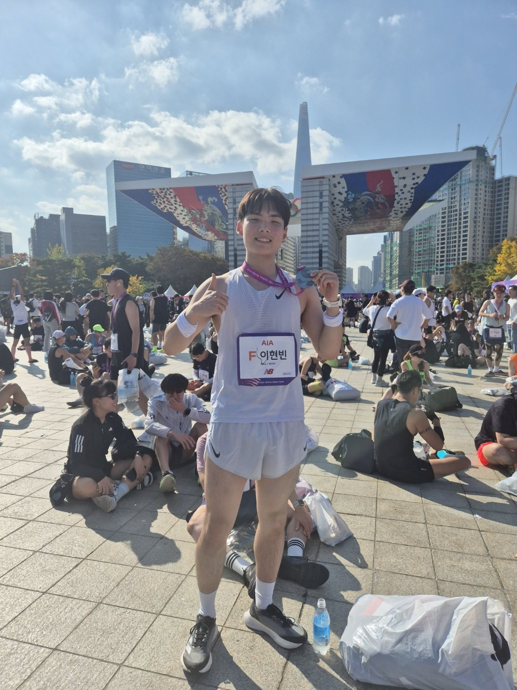
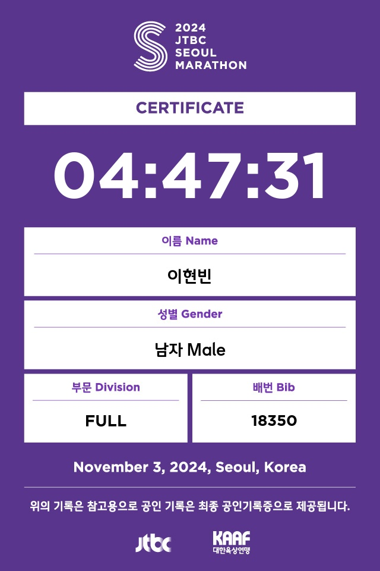

입시 준비로 지난 3개월간 110km 정도밖에 달리지 못하며 마라톤 출전을 망설였지만, JTBC 마라톤의 분위기를 느끼고 싶은 마음에 결국 참여하기로 결심했다. 회송 차량에 탑승할 일이 있더라도 일단 대회장에 가서 뛰어보자는 생각이었다. 대회장에 도착하니 그 분위기는 압도적이었다. 이른 아침, 해가 떠오르며 수만 명의 러너들을 비추는 햇빛이 무척 아름답더라.  

마라톤이 시작되자 만여 명의 사람들과 함께 서울 도심을 달리기 시작했다. 초반엔 발걸음이 가벼웠다. 레이스 직후 몇 km 동안 이어지는 주자들을 위한 응원 분위기는 정말 즐거웠고, 응원하러 오신 분들과 하이파이브를 하며 힘차게 나아갔다. 하지만 10km를 넘어서며 응원 인파가 점차 줄어들었고, 몸도 점점 지쳐갔다. 이때부터는 내 앞을 달리는 아저씨의 뒤통수만 바라보며 고통을 잊고자 했다.  

20km 지점 즈음, 어지러움과 함께 당장이라도 주저앉고 싶다는 생각이 머릿속을 맴돌았다. 그때 앞선 주자가 바닥에 떨어뜨리고 간 아미노 바이탈 하나를 발견했다. 몹시 짓밟혔지만 포장이 뜯기지 않았던 아미노바이탈을 보고 나는 생각할 틈도 없이 허리를 숙여 그것을 집어 들었다. 그것으로부터 일말의 힘이라도 얻고 싶었던 나는 옷으로 포장지를 슥슥 닦고 에너지젤을 빨아먹기 시작했다. 이내 나는 놀라운 경험을 하게 되었다. 정신이 맑아지면서 허벅지의 경련이 풀리는 듯했다. 그때부터 나는 바닥에 떨어져 있는 멀쩡한 에너지젤을 찾기 시작하며 그 순간에 완전히 몰입되었다.  

앞선 러너들이 도로 위 두고 간 에너지젤은 그 순간 오직 나만을 위한 까치밥이었고 그것을 향한 나의 열망은 그간 달려오면서 느꼈던 고통들을 잊게 하며 계속해 앞으로 나아갈 동기를 주었다. 그렇게 계속 달리다 보니 요헤미티와 아미노 바이탈을 하나씩 더 찾으며 30km 지점 부근까지 오게 되었다. 그 무렵 양쪽 대퇴사두근의 경련이 점점 심해지고 있었고 한 걸음 한 걸음 내딛을 때마다 팽팽하게 당겨진 내 근육이 끊어질 것만 같다는 불안감을 주는 고통을 느꼈다.  
잠실 부근으로 들어가 다시 응원 인파가 많아지며 그들이 보낸 열렬한 응원에 힘을 얻어 계속 나아갔다. 태어나서 처음 뵙는 분들이 레몬부터 시작해서 박카스, 꿀물, 콜라까지 건네주며 나의 완주를 위해 열렬한 지지를 해주고 계셨다. 이분들에게 정말 감사하다. 조금씩 앞으로 나아가다 보니 결승 지점이 눈에 들어왔고, 마지막 한 방울의 힘을 쥐어짜 결승선을 통과했다.  

<b>추가로 JTBC 마라톤에서 기억에 남은 몇 가지 순간들</b>  

-   초등학생 시절 살았던 어린이대공원과 광진구청 앞을 지나며 옛 추억을 떠올렸다.
-   긴 도로 끝에 결승선이 있어 멀리서부터 점점 커지는 골라인을 보는 경험이 마라톤을 마무리하기에 최고의 방식이었다.
-   이번 대회에서 응원해 주신 모든 분들께 진심으로 감사드린다. 그분들이 없었다면 완주하지 못했을 것이다.

