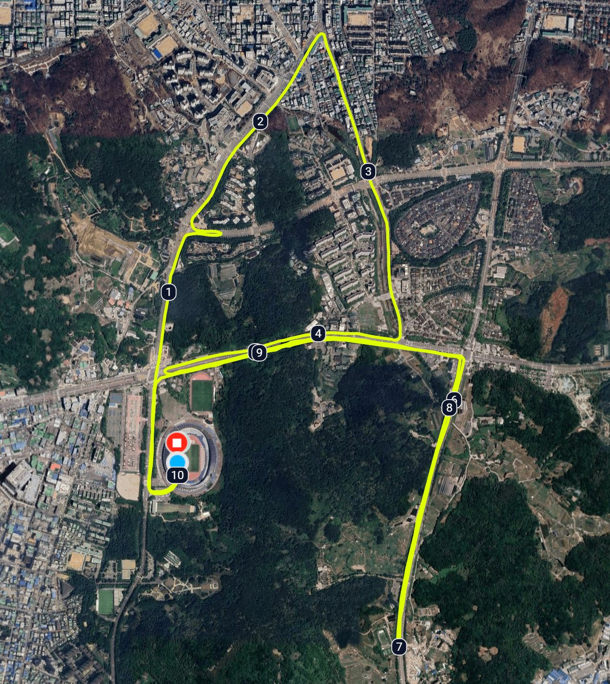
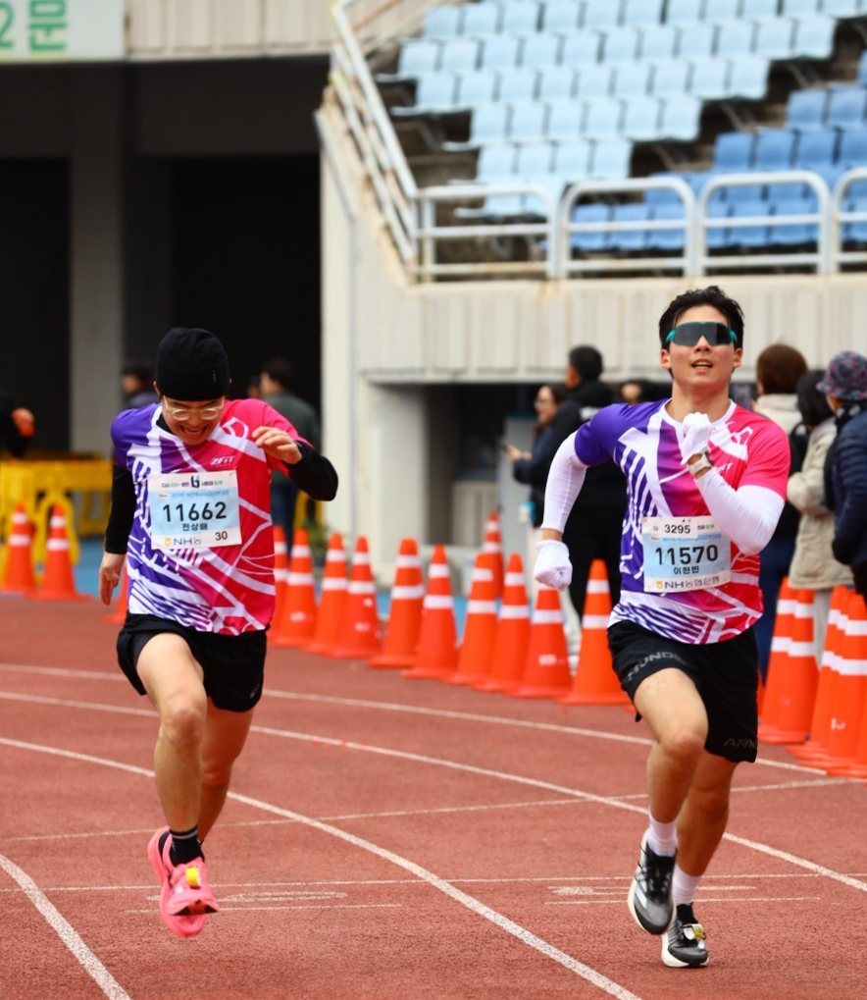
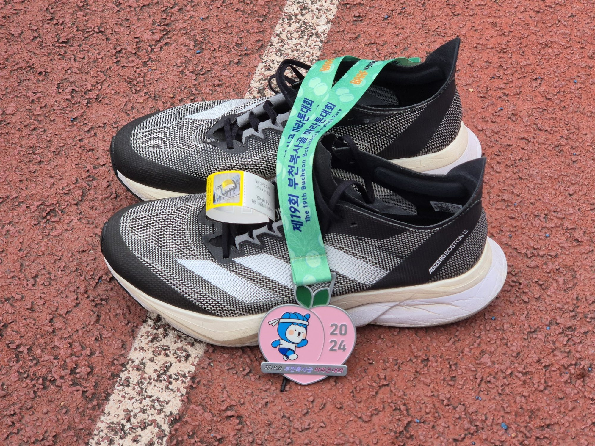
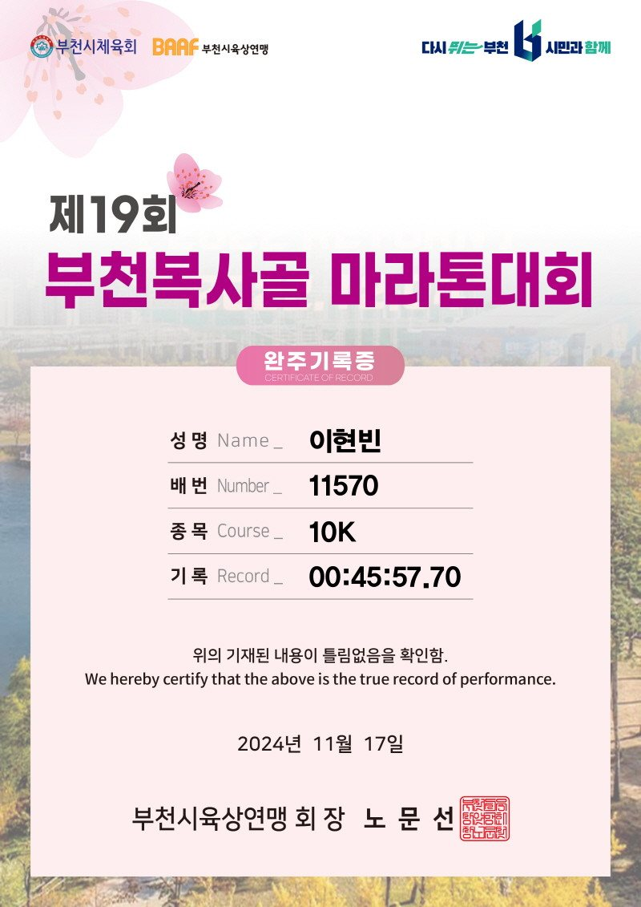

벌써 네 번째 마라톤대회다.

따로 연습을 많이 하지는 못했지만 2주 전쯤 달린 풀코스가 좋은 훈련이 되었던 것 같다.

작년에는 천변을 뛰는 코스가 있었는데 해당 코스가 모두 도로를 뛰는 코스로 바뀌었다.

꽤 긴 언덕을 세 번 오르게 한다는 점이 부천복사골 마라톤대회의 특별한 매력인 것 같다.

45분대를 정말 뛰고 싶었는 데 성공해서 기쁘다.

결승지점으로 달려나가던 순간에는 정말 심한 구토감이 느껴졌다.

가장 힘들게 달린 10km같다.

풀코스를 뛰고 10km를 뛰니 출발부터 완주까지 정말 순식간에 지나간 것 같다.

부천복사골 마라톤대회는 참가비도 3만 원 밖에 안 하고 메달도 귀여운 좋은 대회이다.

