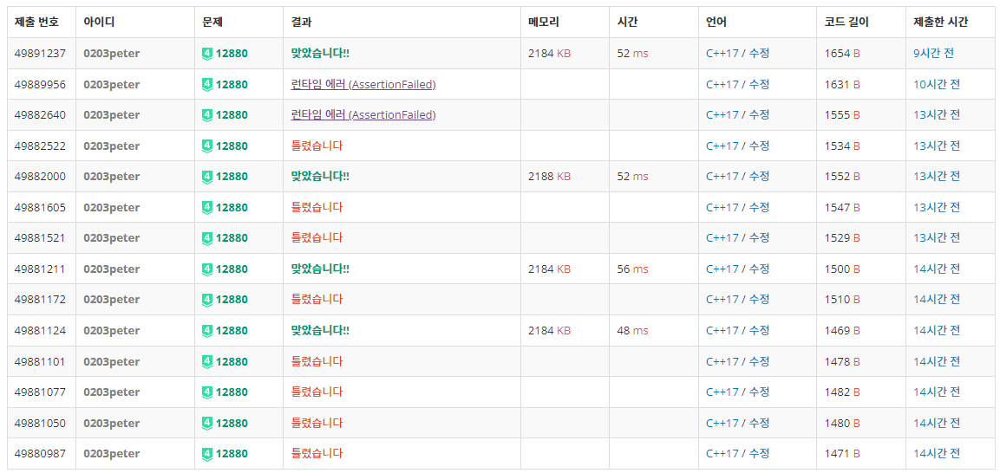

보다시피.. 계속해 놓치던 반례가 있어 많은 WA를 받게 되었다.



문제 접근 과정

처음 읽었을 때  
고등학교 기숙사에서 지내는데 12시 이후 소등이 되고 나서 갑자기 아무 문제나 하나 읽고 잠들기 전까지 고민하고 싶어 겨우겨우 와이파이 신호를 잡고 문제를 로딩하고 읽어 고민을 시작하게 되었다.

임의의 간선 집합을 알고 있을 때 해당 간선 집합으로 모든 정점 중 A와 B를 아무거나 선택하고 A -> B, B -> A 두 가지 경로가 모두 존재하는지 판별하는 방법도 잘 모르고 있었다.

N = 50 밖에 안되었지만 전체적인 문제에 대한 접근 방법이 도저히 감이 잡히지 않아 문제에 대한 가벼운 고민을 2시간 정도 한 이후 해답을 참고하게 되었다. [Justice Hui님의 tistory를 참고하게 되었다](https://justicehui.github.io/ps/2020/07/04/BOJ12880/).

간선들을 하나로 정리하여 좌표압축을 해주어 n^2 개의 가중치 상한 과 하한을 얻을 수 있다.

n^2개의 간선에 대해서 투 포인터를 진행해주게 되고 ava 함수를 통해 n^2의 시간 동안 해당 구간(하한\~상한)의 간선들로 조건을 만족하는 그래프를 그려줄 수 있는지 확인하는 것이다.

다음은 내가 문제를 풀며 계속해 찾지 못하던 반례이다.

62번 줄에 if(i == j) continue;의 구문에서 발생한 문제이다. 스스로에게 가는 상황은 불필요하다. (사실이다) 하지만 입력되는 n이 1인 경우 어떨까? 배열 cp에 어떠한 원소도 추가되지 않게 되며 ans 변수는 초기화된 값 INF로 그대로 출력되게 된다. 이러한 문제를 해결해주기 위해 n = 1인 경우 0을 출력해주고 return 0; 하는 방법을 통해 문제를 해결하였다.

시간 복잡도 : O(n^4)

소요 시간 : 측정 불가

아쉬운 점

아직은 골드 1 이상의 문제를 혼자 편하게 풀어내는데 어려움이 있는 것 같다. 이번의 경우에도 스스로는 해답 근처까지도 접근하지 못해 많은 아쉬움이 남는다. 답을 확인 한 이후에는 이해가 어렵지 않은 로직인 것 같은데 더 많은 연습이 필요할 것 같다. 또한 n 이 1인 것 과 같은 흔한 반례 케이스를 전혀 생각해내지 못한 부분 또한 아쉬움으로 남는다.

전체적인 감상

이 코드에서 사용되는 ava, dfs 함수에 대한 더욱 깊은 이해를 하기 위해 노력해야겠다는 생각을 하게 된다.

```cpp
/* basic setup {{{ */
#include<bits/stdc++.h>
using namespace std;
typedef long long ll;
typedef pair<int,int> pii;
typedef pair<ll,ll> pll;
#define ff first
#define ss second
#define pb push_back
#define sz(x) ((int)x.size())
#define all(x) x.begin(),x.end()
#define compress(x) sort(all(x)), x.erase(unique(all(x)), x.end())
#define fast_io ios_base::sync_with_stdio(0),cin.tie(0)
const int MOD = 1e9+7;
const int INF = 0x3f3f3f3f;
const ll LINF = 0x3f3f3f3f3f3f3f3f;
/*}}}*/
const int BN = 55;
ll n, ar[BN][BN], cnt;
bool chk[BN];
vector<ll> cp;

void dfs(int cur, int l, int r, bool con){
	cnt++; chk[cur] = 1;

	for(int i=1;i<=n;i++){
		if(cur == i) continue;
		if(con){
			if(!chk[i] && l <= ar[cur][i] && ar[cur][i] <= r) dfs(i, l, r, con);
		}
		else{
			if(!chk[i] && l <= ar[i][cur] && ar[i][cur] <= r) dfs(i, l, r, con);
		}
	}
}

bool ava(int l, int r){
	memset(chk, 0, sizeof chk);
	cnt = 0;
	dfs(1, l, r, 0);

	if(cnt != n) return 0;

	memset(chk, 0, sizeof chk);
	cnt = 0;
	dfs(1, l, r, 1);

	return cnt == n;
}

int main(){
	fast_io;
	cin>>n;
    if(n==1){
        cout<<0;
        return 0;
    }
	for(int i=1;i<=n;i++) for(int j=1;j<=n;j++) cin>>ar[i][j];

	for(int i=1;i<=n;i++){
		for(int j=1;j<=n;j++){
			if(i == j) continue;
			// 이 코드에서  n이 1 인 경우
			// 문제가 생김

			cp.pb(ar[i][j]);
		}
	}
	compress(cp);

	ll ans = INF;
	int l = 0, r = 0;
	// two pointer
	for(; r<sz(cp); r++) for(; l <= r; l++){
		// l을 초기화하지 않으며 해당 l이 이전에 가능했다면 현재도 가능할 것이다.
		if(ava(cp[l], cp[r])) ans = min(ans, cp[r] - cp[l]);
		else break;
	}
	cout<<ans;
	cout<<'\n';
}
```
