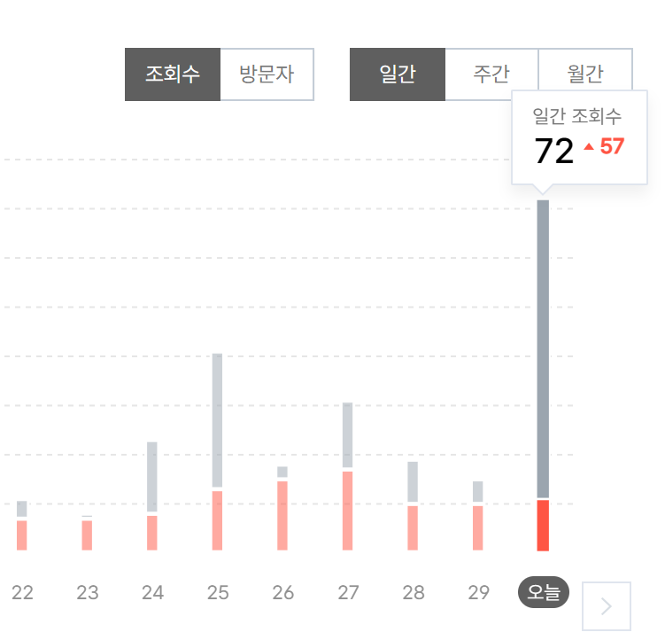

최근 누가 내 블로그를 막 읽는다.

이렇게 기록이 많이 찍히면 누가 이렇게 내 글에 관심을 가지는지 궁금하다.

만약 이 글도 읽는다면 나에게 연락해 달라.

그나저나 요즘 광주과학기술원에서 공부 중인데 여러 일들이 꽤 잘 풀리고 있다.

가장 중요한 것은 내부적인 변화다.

원래 하루라도 최선을 다해보고 싶다는 생각을 매일같이 하며 단 한 시간도 노력하지 않았다.

과학기술원에 오고 나 스스로를 노력할 수밖에 없는 환경에 놓임과 함께 훌륭한 주변인들의 모습을 보다 보니 최근에는 이틀정도는 열심히 살았다고 자부할 수 있다.

실제로 외부적으로 다가오는 보상도 만족스럽다. GIST Sprint for Startup 프로그램으로 300만 원을 지원받았고 달리기를 주제로 한 GIST 무한도전으로 250만 원을 지원받았으며 GIST 호남권 창업아이디어경진대회에서 우수상 200만 원을 수상했다.

오랜 시간 동안 준비했던 미국 대학들로부터 엄청난 양의 불합격 통보를 받으며 내가 실제 어느 정도의 가치와 능력을 가진 사람인지 스스로 의심이 들었고 스스로에게 보여주고 싶었다. 물론 여전히 개선할 부분이 충분히 많지만 근래의 방향성에 만족하고 있다.
