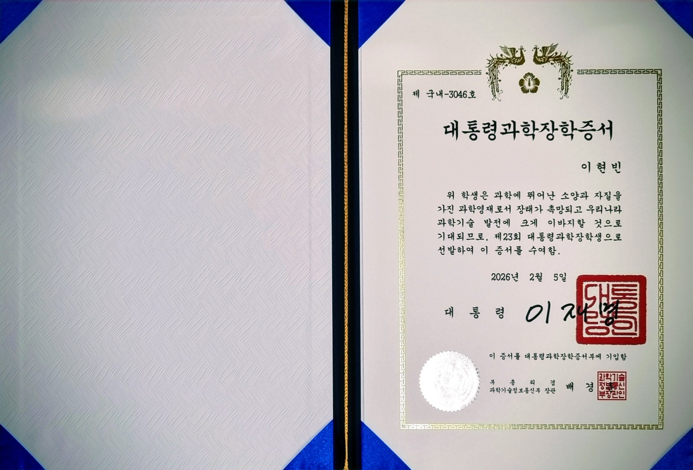

지난 12월 30일 군에 입대했다.  

군대를 기준으로 그전과 후의 내가 크게 달라질 것 같다는 생각이 든다.  

그래서 대통령과학장학증서를 받은 이 시점을 기점으로 하여 나를 한 번 정리하고자 이 글을 적는다.

서울구남초등학교, 청심국제중학교, 그리고 청심국제고등학교를 졸업했다.  

이 단계들을 거치며 나의 삶에 대한 주인의식은 점차 성장했다.  

이제는 내 주변에 무슨 상황이 발생하더라도 나 이외에 책임을 돌릴 곳이 없다는 사실을 직시한다.  

지금껏 과거의 후회와 반성에 빠져있는 데에 많은 주의력을 사용해 왔다.  

그렇지만 앞으로의 삶 속에서는 나의 지평에 무엇이 있을지 찾아나가는 삶을 살고자 한다.  

지난 곡절들은 마음 한편에 묻어두고 내 미래에 놓인 만천의 변화들 속에서 최선의 것을 잡고 올라타리라.  

다들 정말 고맙다.
