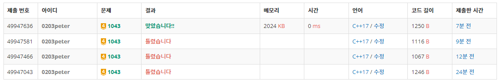

문제를 보고 Union-Find 알고리즘을 사용해야겠다는 것은 어렵지 않게 떠올렸다.



풀이

"<span style="color:#555555">거짓말쟁이로 알려지지 않으면서, 과장된 이야기를 할 수 있는 파티 개수의 최댓값을 구하는 프로그램을 작성하시오.</span>"

이 문장은 "진실을 아는 사람과 전혀 관련 없는 사람들만 모인 파티 개수를 구하는 프로그램을 작성하시오."라고 바꿀 수 있다고 생각한다.

N명의 사람들을 두 가지 부류, \[진실을 아는 사람과 관련 있는 사람들\]과 \[진실을 아는 사람과 관련 없는 사람들\]로 나눌 수 있다.

\[진실을 아는 사람과 관련 있는 사람들\]인지 어떻게 판단할 수 있을까?

다음의 문장들은 문제를 읽고 나서 얻을 수 있는 정보이다.

1\. 지민이는 진실을 아는 사람이 함께하는 파티에서 거짓말을 할 수 없다.

2\. 진실을 모르는 사람이 진실을 아는 사람과 함께 파티에 참여하면 진실을 알게 된다.

3\. 임의의 사람 A가 나중에라도 사실을 알게 될거라면 이전에도 거짓말을 해서는 안된다.

따라서 "진실을 안다"라는 특성은 같은 파티에 참여했을 때 해당 파티의 파티원들에게 모두 전염된다는 특징을 가지게 되고 이를 Union-Find로 구현해주어 \[진실은 아는 사람과 관련 있는 사람들\] 인지 확인할 수 있는 것이다.

3번의 틀렸습니다를 받은 이유

union을 통해 파티를 하나로 묶어주는 부분을 처음에는 p 배열에 바로 값을 대입해주는 작업으로 대체할 수 있다고 생각했다. 하지만 이것은 불가능하다. 이유는 간단하니 스스로 생각해보기를 바란다.

시간 복잡도 : O(N\*M) (Union-find의 시간복잡도를 상수로 볼 경우)

소요 시간 : 측정 불가

아쉬운 점

union 함수의 사용이 당연한데 사용하지 않았을 때의 문제점을 바로 캐치하지 못한 것이 아쉽다.

전체적인 감상

주말이라 그런지 컨디션이 별로여서 문제를 푸는데 계속해 늘어지게 되었다.

```cpp
/* basic setup {{{ */
#include<bits/stdc++.h>
using namespace std;
typedef long long ll;
typedef pair<int,int> pii;
typedef pair<ll,ll> pll;
#define ff first
#define ss second
#define pb push_back
#define sz(x) ((int)x.size())
#define all(x) x.begin(),x.end()
#define compress(x) sort(all(x)), x.erase(unique(all(x)), x.end())
#define fast_io ios_base::sync_with_stdio(0),cin.tie(0)
const int MOD = 1e9+7;
const int INF = 0x3f3f3f3f;
const ll LINF = 0x3f3f3f3f3f3f3f3f;
/*}}}*/
const int BN = 51;
int n, m, ans, p[BN];
vector<vector<int>> vc;

// library 'uni.cpp'{{{
//
/*lib*/
int find(int x){
	if(x == -1) return -1;
	if(p[x] == x) return x;
	return p[x] = find(p[x]);
}
void union_(int x, int y){
	x = find(x);
	y = find(y);
	if(x < y) swap(x, y);
	p[x] = y;
}
/*lib*//*}}}*/

int main(){
	for(int i=1;i<=50;i++) p[i] = i;
	fast_io;
	cin>>n>>m;
	int k;
	cin>>k;
	for(int i=0;i<k;i++){
		int f;
		cin>>f;
		p[f] = -1;
	}

	vc.resize(m);
	for(int i=0;i<m;i++){
		int f;
		cin>>f;
		vc[i].resize(f);
		int mn = INF;
		for(int j=0;j<f;j++){
			cin>>vc[i][j];
			mn = min(mn, p[vc[i][j]]);
		}
		for(int j=0;j<f;j++){
			union_(vc[i][j], mn);
		}
	}
	int ans = 0;
	for(int i=0;i<m;i++){
		if(find(vc[i][0]) != -1) ans++;
	}
	cout<<ans;
	cout<<'\n';
}
```
