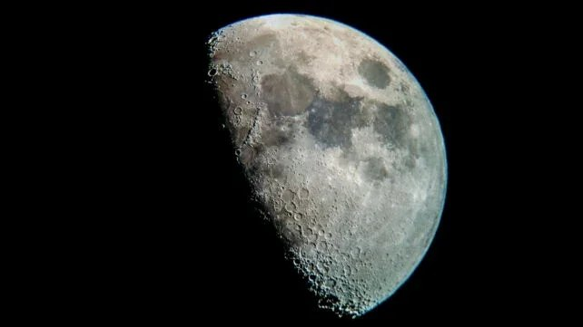

군생활하며 달에 매료되었다.

하늘 높이 떠다니는 거대한 돌덩어리를 보며, 그 돌덩어리가 반사하는 밝은 태양빛을 보며 알 수 없는 위로를 받는다.

이래서인지 인류가 달을 적극 활용하는 미래를 기대하게 되었고 나는 이 미래로 나아가기 위해 달에 건물을 짓고 인간이 살 수 있으려면 어떠한 조건이 갖추어져야 하는지 심각한 조사를 해보려고 한다.

다음 주에 실행하는 완벽한 계획보다 지금 당장 실행하는 좋은 계획이 훨씬 낫다는 생각이 내 머릿속에서 공명한다.

나는 언젠가 달에 살 수도 있다.
