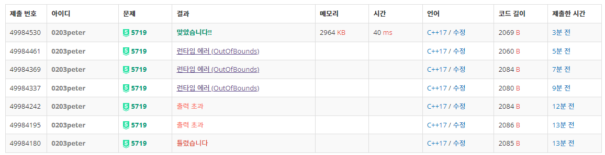

문제 티어를 가리고 풀었더니 플래티넘 문제가 평소보다 더 쉽게 풀리는 느낌...



풀이

코드의 전체적인 순서

1\. m개의 간선을 입력받을 때 정방향 간선과 함께 역방향 간선 또한 입력받아준다.

2\. 정방향 간선의 기본 그래프에 대해(문제에서 제시하는 기본 형태) dijkstra's algorithm을 사용하여 모든 정점의 시작노드로부터의  거리를 구한다

3\. 역방향 간선을 통해 종료노드부터 조건이 있는 BFS 탐색을 하며 사용된 간선들을 used 배열에 표시해준다(모든 노드에 대해 새 번호를 부여해 최단 경로에 포함되는 간선인지 체크해줬다)

4\. 정방향 간선의 기본 그래프에 대해 조건문으로 간선의 used 배열 체크와 함께 dijkstra's algorithm을 사용하여 모든 정점의 시작 노드로부터의 거리를 구한다

5\. 정답은 4번에서 구한 시작 정점부터 종료 정점까지 소요된 거리다

시간 복잡도 : O($m \\log n$)

소요 시간 : 측정 불가

아쉬운 점

어렵지 않은 아이디어인데 정답까지 접근하는데에 꽤 돌아서 갔다

전체적인 감상

class 6 문제를 풀며 솔브닥 티어를 가리고 풀게 되었는데 큰 난관 없이 해당 문제를 풀고 나니 원래 있었던 플래티넘 티어에 대한 두려움이 해소된 느낌이다.

```cpp
/* basic setup {{{ */
#include<bits/stdc++.h>
#define ff first
#define ss second
#define pb push_back
#define sz(x) ((int)x.size())
#define all(x) x.begin(),x.end()
#define compress(x) sort(all(x)), x.erase(unique(all(x)), x.end())
#define fast_io ios_base::sync_with_stdio(0),cin.tie(0)
using namespace std;
typedef long long ll;
typedef pair<int,int> pii;
typedef pair<ll,ll> pll;
typedef const int ci;
const int MOD = 1e9+7;
const int INF = 0x3f3f3f3f;
const ll LINF = 0x3f3f3f3f3f3f3f3f;
/*}}}*/
ci BN = 501, AN = 10001;
ll n, m, s, e, u, v, p, d[BN], cnt;
bool vis[BN], used[AN];
vector<vector<pair<pll,ll>>> adj, rev;
priority_queue<pll> pq;
queue<pll> q;

void dijk(){
	memset(d, 0x3f, sizeof d);

	pq.push({0, s});
	d[s] = 0;

	while(!pq.empty()){
		pll tp = pq.top();
		pq.pop();
		ll cost = -tp.ff, cur = tp.ss;
		if(cost > d[cur]) continue;
		for(auto nx : adj[cur]){
			if(cost + nx.ss < d[nx.ff.ff]){
				d[nx.ff.ff] = cost + nx.ss;
				pq.push({-d[nx.ff.ff], nx.ff.ff});
			}
		}
	}

	memset(vis, 0, sizeof vis);
	q.push({d[e], e});
	vis[e] = 1;

	while(!q.empty()){
		pll fr = q.front();
		q.pop();

		ll cost = fr.ff, cur = fr.ss;
		for(auto bx : rev[cur]){
			if(cost - bx.ss == d[bx.ff.ff]){
				if(!vis[bx.ff.ff]){
					vis[bx.ff.ff] = 1;
					q.push({d[bx.ff.ff], bx.ff.ff});
				}
				used[bx.ff.ss] = 1;
			}
		}
	}

	memset(d, 0x3f, sizeof d);
	pq.push({0, s});
	d[s] = 0;
	while(!pq.empty()){
		pll tp = pq.top();
		pq.pop();

		ll cost = -tp.ff, cur = tp.ss;
		if(cost > d[cur]) continue;
		for(auto nx : adj[cur]){
			if(used[nx.ff.ss]) continue;

			if(cost + nx.ss < d[nx.ff.ff]){
				d[nx.ff.ff] = cost + nx.ss;
				pq.push({-d[nx.ff.ff], nx.ff.ff});
			}
		}
	}
}
void init(){
	memset(used, 0, sizeof used);
	adj.clear();
	rev.clear();
	adj.resize(n);
	rev.resize(n);
	cnt = 0;
}

int main(){
	fast_io;
	while(1){
		cin>>n>>m;
		if(n == 0) break;

		init();
		cin>>s>>e;
		for(int i=0;i<m;i++){
			cin>>u>>v>>p;
			adj[u].pb({{v, cnt}, p});
			rev[v].pb({{u, cnt}, p});
			cnt++;
		}

		dijk();

		cout<<((d[e]==LINF)?-1:d[e])<<'\n';
	}
}
```
