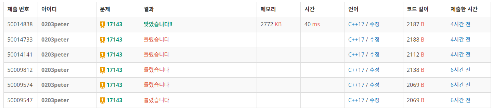

맞왜틀의 지옥 시뮬레이션



풀이

상어에 대해 입력으로 주어지는 초기 정보 5개(r, c, s, d, z)와 상어가 낚시왕에게 잡혔거나 다른 상어에게 먹혔는지 확인하는 bool을 하나로 묶어 shark 구조체를 만들어 주었다

낚시왕이 m번 움직이며 잡을 상어를 확인한다.

초기 정보와 현재 몇 번째 이동인지 알고 있으면 현재 상어가 있어야 할 위치를 알 수 있다.

이를 토대로 mapper 배열에 상어의 바뀐 위치를 표시해주고 가까이 있는 상어를 잡아준다.

mapper 배열을 확인하며 상어가 잡히거나 먹혔는지 확인해준다

사실 그냥 시뮬레이션 문제이기 때문에 크게 따로 풀이를 소개할만한 부분이 없다.

시간 복잡도 : $O(mc)$

소요 시간 : 측정 불가

아쉬운 점

구현하는데 1을 11로 적어놓고 틀린부분을 찾지 못해 괜한 고생을 했다. 다음부터 이러지 말자

전체적인 감상

문제와 입력 제한을 보자마자 "아, 시뮬레이션 문제구나 하지 말아야지" 생각했다. 하지만 class 문제는 모두 풀겠다는 생각으로 문제를 풀기 시작하였다. 예상대로 맞왜틀을 엄청 하다 너무 사소한 실수를 했다는 것을 발견하였다. 그래도 풀고 나니 만족스럽다.

```cpp
/* basic setup {{{ */
#include<bits/stdc++.h>
#define ff first
#define ss second
#define pb push_back
#define sz(x) ((int)x.size())
#define all(x) x.begin(),x.end()
#define compress(x) sort(all(x)), x.erase(unique(all(x)), x.end())
#define fast_io ios_base::sync_with_stdio(0),cin.tie(0),cout.tie(0)
using namespace std;
typedef long long ll;
typedef pair<int,int> pii;
typedef pair<ll,ll> pll;
typedef const int ci;
const int MOD = 1e9+7;
const int INF = 0x3f3f3f3f;
const ll LINF = 0x3f3f3f3f3f3f3f3f;
/*}}}*/
struct shark{
	int x, y, sp, way, sze;
	bool termin = 0;

	shark(int _x,int _y,int _sp,int _way,int _sze) : x(_x),y(_y),sp(_sp),way(_way),sze(_sze){};
};
ci BN = 111;
int n, m, k, r, c, s, d, z, mapper[BN][BN], ans;
vector<shark> vc;

shark conv(shark f, int tm){/*{{{*/
	shark ret = f;
	int blk = (f.sp)*tm;
	int man;

	if(f.way == 1){
		blk += (f.x-1)+((n-1)-(f.x-1))*2;

		man = (blk-1)/(n-1);
		blk = ((blk-1)%(n-1))+1;
		if(man%2 == 0) ret.x = blk+1;
		else ret.x = n-blk;
	}
	else if(f.way == 2){
		blk += (f.x-1);

		man = (blk-1)/(n-1);
		blk = ((blk-1)%(n-1))+1;
		if(man%2 == 0) ret.x = blk+1;
		else ret.x = n-blk;
	}
	else if(f.way == 3){
		blk += f.y-1;

		man = (blk-1)/(m-1);
		blk = ((blk-1)%(m-1))+1;
		if(man%2 == 0) ret.y = blk+1;
		else ret.y = m-blk;
	}
	else if(f.way == 4){
		blk += (f.y-1)+((m-1)-(f.y-1))*2;

		man = (blk-1)/(m-1);
		blk = ((blk-1)%(m-1))+1;
		if(man%2 == 0) ret.y = blk+1;
		else ret.y = m-blk;
	}
	assert(ret.x >= 1 && ret.x <= n && ret.y >= 1 && ret.y <= m);
	return ret;
}/*}}}*/

int main(){
	fast_io;
	cin>>n>>m>>k;
	for(int i=0;i<k;i++){
		cin>>r>>c>>s>>d>>z;
		vc.pb(shark(r, c, s, d, z));
	}
	assert(sz(vc) == k);

	for(int i=0;i<m;i++){

		memset(mapper, 0, sizeof mapper);
		for(shark f : vc){
			if(f.termin) continue;
			shark an = conv(f, i);
			mapper[an.x][an.y] = max(mapper[an.x][an.y], an.sze);
		}

		for(int j=1;j<=n;j++){
			if(mapper[j][i+1]){
				assert(mapper[j][i+1] != -1);
				ans += mapper[j][i+1];
				mapper[j][i+1] = -1;
				break;
			}
		}

		for(shark &f : vc){
			if(f.termin) continue;
			shark an = conv(f, i);
			if(mapper[an.x][an.y] != an.sze) f.termin = 1;
		}
	}

	cout<<ans;
	cout<<'\n';
}
```
