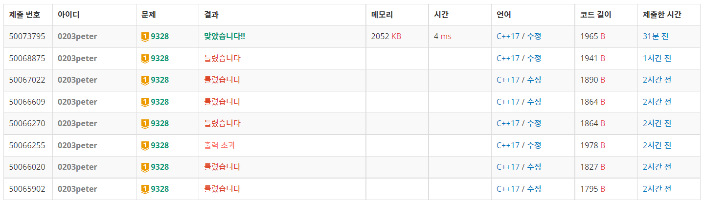

물 흐르듯이 한 구현에 실수 하나가 끼어서 많은 틀렸습니다를 받았다.



풀이

입력으로 주어지는 평면도를 둘러싸는 길을 추가하여 bfs를 진행한다.

모든 위치에 최대 한 번씩만 방문하기 위해 방문 시 vis 배열에 체크되어있거나 해당 위치가 벽이라면 continue 해주고 아니라면 로직을 진행하고. 해당 위치의 vis 배열을 1 처리해준다.

로직은 다음과 같다

위치 하나가 있을 때 해당 위치의 상, 하, 좌, 우를 탐색하여 준다.

상, 하, 좌, 우에 방문하였을 때 이동한 위치를 해당 위치라고 하자

해당 위치에 "문서"가 있다면

\[출력 결과에 1을 더해준다\] \[queue에 해당 위치를 push 해준다\]

해당 위치에 "열쇠"가 있다면

\[queue에 해당 위치를 push 해준다\] \[열쇠를 얻었음을 col 배열에 체크해준다\] \[열쇠를 얻기 전까지 저장해두었던 도달 가능했던 열쇠에 해당하는 문들을 queue에 push 해준다\] \[해당 키에 맞는 문 dor 배열 clear\]

해당 위치에 "문"이 있다면

\[열쇠가 있는 경우, 해당 위치를 queue에 push\] \[열쇠가 없는 경우, 해당 위치를 dor에 push 해두기\]

해당 위치에 "길"이 있다면

\[queue에 해당 위치를 push 해준다\]

시간 복잡도 : $O(h+w)$

소요 시간 : 측정 불가

아쉬운 점

요즘 계속 구현 아이디어는 완벽히 구상해놓고 구현 부분에서 사소한 실수를 해 시간을 낭비하는 경우가 많다. 이번에도 key를 찾은 부분에서 bfs를 진행시켜주지 않아(queue에 해당 위치를 push 해주지 않아) 생긴 문제이다. 이러한 사소한 구현 실수를 줄이고 코딩을 빠르게 하기 위해 어떠한 노력이 필요할지 고민이 필요할 것 같다.

전체적인 감상

기본적인 bfs 문제에 적당한 아이디어가 섞인 재밌는 문제라고 생각한다.

```cpp
/* basic setup {{{ */
#include<bits/stdc++.h>
#define ff first
#define ss second
#define pb push_back
#define sz(x) ((int)x.size())
#define all(x) x.begin(),x.end()
#define compress(x) sort(all(x)), x.erase(unique(all(x)), x.end())
#define fast_io ios_base::sync_with_stdio(0),cin.tie(0),cout.tie(0)
using namespace std;
typedef long long ll;
typedef pair<int,int> pii;
typedef pair<ll,ll> pll;
typedef const int ci;
const int MOD = 1e9+7;
const int INF = 0x3f3f3f3f;
const ll LINF = 0x3f3f3f3f3f3f3f3f;
/*}}}*/
ci BN = 111;
int n, m, ans;
bool col[26], vis[BN][BN];
char ar[BN][BN];
string s1;
int dx[] = {0, 0, -1, 1}, dy[] = {1, -1, 0, 0};
vector<pii> dor[26];

void init(){
	memset(col, 0, sizeof col);
	memset(vis, 0, sizeof vis);
	memset(ar, 0, sizeof ar);
	ans = 0;
	for(int i=0;i<26;i++) dor[i].clear();
}
bool inrange(int x, int y){
	return (x >= 0 && x <= n+1 && y >= 0 && y <= m+1);
}

int main(){
	fast_io;
	int t;
	cin>>t;

	while(t--){
		init();
		cin>>n>>m;
		for(int i=1;i<=n;i++){
			for(int j=1;j<=m;j++){
				cin>>ar[i][j];
			}
		}

		cin>>s1;
		if(s1[0] != '0') for(char c : s1) col[c-'a'] = 1;

		queue<pii> q;
		q.push({0, 0});
		vis[0][0] = 1;

		while(!q.empty()){
			pii fr = q.front();
			q.pop();

			for(int o=0;o<4;o++){
				int cx = fr.ff+dx[o], cy = fr.ss+dy[o];
				if(inrange(cx, cy)){
					char c = ar[cx][cy];
					if(vis[cx][cy] || c == '*') continue;

					if(c == '$'){
						ans++;
						q.push({cx, cy});
					}
					else if(c >= 'a' && c <= 'z'){
						if(col[c-'a']) assert(dor[c-'a'].empty());
						q.push({cx, cy});
						col[c-'a'] = 1;
						for(pii pl : dor[c-'a']){
							q.push({pl.ff, pl.ss});
						}
						dor[c-'a'].clear();
					}
					else if(c >= 'A' && c <= 'Z'){
						if(col[c-'A']){
							q.push({cx, cy});
						}
						else{
							dor[c-'A'].pb({cx, cy});
						}
					}
					else{
						q.push({cx, cy});
					}
					vis[cx][cy] = 1;
				}
			}
		}
		assert(vis[n+1][m+1]);
		cout<<ans<<'\n';
	}
}
```
