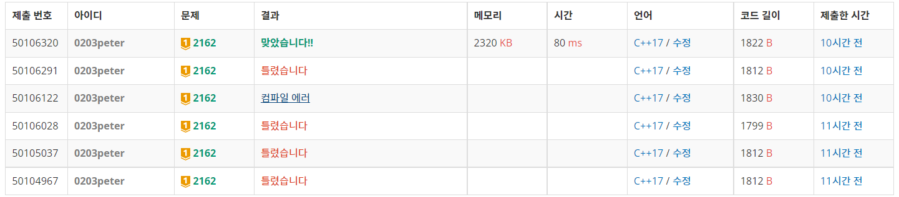

재밌는 기하학 문제 하하하



풀이

선분 교차 알고리즘을 활용한다

이중 for문을 통해 두 선분이 교차하는지 선분 교차 알고리즘을 활용해 확인해준다.

만약 교차한다면 union 해준다 이때 집합의 크기를 알기 위해 sz 배열을 관리해주는 것이 중요하다.

만들어진 집합들의 개수와 최대 사이즈를 확인하여 출력한다.

선분 교차 알고리즘은 [선분 교차 2](https://www.acmicpc.net/problem/17387)  의 구현을 그대로 가져다 사용하였다.

시간 복잡도 : $O(n^2)$

소요 시간 : 측정 불가

아쉬운 점

요즘 이런 거 구현하는 게 너무 귀찮다. 사춘기인가?

전체적인 감상

내가 나가는 대회에는 기하학 문제는 안 나왔으면 좋겠다.

```cpp
/* basic setup {{{ */
#include<bits/stdc++.h>
#define ff first
#define ss second
#define pb push_back
#define sz(x) ((int)x.size())
#define all(x) x.begin(),x.end()
#define compress(x) sort(all(x)), x.erase(unique(all(x)), x.end())
#define fast_io ios_base::sync_with_stdio(0),cin.tie(0),cout.tie(0)
using namespace std;
typedef long long ll;
typedef pair<int,int> pii;
typedef pair<ll,ll> pll;
typedef const int ci;
const int MOD = 1e9+7;
const int INF = 0x3f3f3f3f;
const ll LINF = 0x3f3f3f3f3f3f3f3f;
/*}}}*/
ci BN = 3011;
int n, i1, i2, i3, i4, p[BN], sz[BN];
vector<pair<pii,pii>> vc;

// library 'uni.cpp'{{{
/*lib*/
int find(int x){
	if(p[x] == x) return x;
	return p[x] = find(p[x]);
}
void union_(int x, int y){
	x = find(x);
	y = find(y);
    if(x == y) return;
	p[x] = y;
	sz[y] += sz[x];
}
/*lib*//*}}}*/

int CCW(pll a, pll b, pll c){
	ll d = a.ff*b.ss + b.ff*c.ss + c.ff*a.ss - (a.ss*b.ff + b.ss*c.ff + c.ss*a.ff);

	if(d > 0) return 1;
	if(d == 0) return 0;
	return -1;
}
bool connec(pii a, pii b, pii c, pii d){
	int p1 = CCW(a, b, c);
	int p2 = CCW(a, b, d);
	int q1 = CCW(c, d, a);
	int q2 = CCW(c, d, b);

	if(p1*p2 == 0 && q1*q2 == 0){
		if(a > b) swap(a, b);
		if(c > d) swap(c, d);

		if(a <= d && c <= b) return 1;
		else return 0;
	}
	else{
		if(p1*p2 <= 0 && q1*q2 <= 0) return 1;
		return 0;
	}
}

int main(){
	fast_io;
	cin>>n;
	for(int i=0;i<=3000;i++) p[i] = i;
	for(int i=0;i<=3000;i++) sz[i] = 1;

	for(int i=0;i<n;i++){
		cin>>i1>>i2>>i3>>i4;
		vc.pb({{i1, i2}, {i3, i4}});
	}
	for(int i=0;i<n;i++){
		for(int j=i+1;j<n;j++){
			if(connec(vc[i].ff, vc[i].ss, vc[j].ff, vc[j].ss)){
				union_(i, j);
			}
		}
	}

	set<int> st;
	int ans = 0;

	for(int i=0;i<n;i++){
		st.insert(find(i));
	}
	for(int i=0;i<n;i++) ans = max(ans, sz[find(i)]);

	cout<<sz(st)<<'\n';
	cout<<ans;
	cout<<'\n';
}
```
