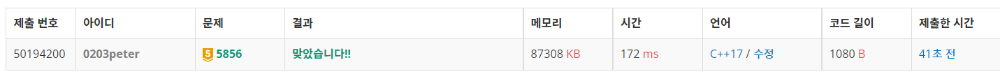

이게... 왜... 됨?



어려운 문제를 풀고 싶지 않아서 과거의 USACO Silver 문제 중 티어가 낮은 문제를 하나 골라 풀었다.

정말 생각없이 읽고 생각하고 코드 짜서 제출했더니 정답이 나와서 당황스러웠다.

BFS + set 을 통해서 친구 집합을 만들어놓고 k-1개의 조건이 충족된 경우 나머지 한 마리를 제거하며 queue에 push 해 BFS를 진행시켜주었다. 소 자체를 chk 배열에 확인하는 것이 아닌 cow group 단위로 chk 배열을 확인해주며 BFS를 진행할 수 있는가에 대해 고민해보면 좋을 것 같다.

시간 복잡도 : $O(n\\log n)$

소요 시간 : 5분?

아쉬운 점

머리가 너무 안돌아가서 시간 복잡도를 제대로 적었는지조차 잘 모르겠다.

전체적인 감상

USACO 문제는 티어에 관계없이 머리를 복잡하게 만드는 매력이 있는 것 같다.

```cpp
/* basic setup {{{ */
#include<bits/stdc++.h>
#define ff first
#define ss second
#define pb push_back
#define sz(x) ((int)x.size())
#define all(x) x.begin(),x.end()
#define compress(x) sort(all(x)), x.erase(unique(all(x)), x.end())
#define fast_io ios_base::sync_with_stdio(0),cin.tie(0),cout.tie(0)
using namespace std;
typedef long long ll;
typedef pair<int,int> pii;
typedef pair<ll,ll> pll;
typedef const int ci;
const int MOD = 1e9+7;
const int INF = 0x3f3f3f3f;
const ll LINF = 0x3f3f3f3f3f3f3f3f;
/*}}}*/
ci BN = 1000001;
int n, g, f;
vector<int> vc[BN];
set<int> st[BN];
bool vis[BN];

int main(){
	fast_io;
	cin>>n>>g;
	for(int i=0;i<g;i++){
		cin>>f;
		for(int j=0;j<f;j++){
			int k;
			cin>>k;
			vc[k].pb(i);
			st[i].insert(k);
		}
	}

	queue<int> q;
	vis[1] = 1;
	int ans = 1;
	q.push(1);

	while(!q.empty()){
		int fr = q.front();
		q.pop();

		for(int i : vc[fr]){
			st[i].erase(fr);

			if(sz(st[i]) == 1){
				int a = *st[i].begin();
				st[i].clear();
				if(vis[a]) continue;
				vis[a] = 1;
				ans++;
				q.push(a);
			}
		}
	}

	cout<<ans;
	cout<<'\n';
}
```
