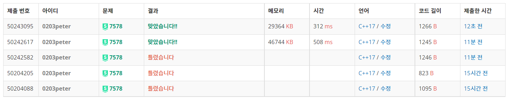

처음 문제를 읽고 세그먼트 트리 문제인지 바로 감을 잡지 못해 고민을 많이 하였다.



풀이

해당 문제는 A열에서 먼저 나왔는데 B 열에는 나중에 위치해있는 기계의 쌍을 찾는 문제이다.

주어진 n 순서대로 진행을 해주며 A열에서 자신보다 먼저 나온 기계의 번호가 B열에서 자신과 매칭 되는 기계 뒤에 몇 개나 있는지 구간합을 구해주는 것이다. 이를 segment tree를 통해서 처리해줄 수 있다.

정답을 받고 난 이후로 unordered\_map이 아닌 그냥 int 배열을 통해 라벨링을 다시 하는 과정을 해주었는데 확실히 더 빠른 모습을 볼 수 있었다.

시간 복잡도 : $O(n \\log n)$

소요 시간 : 하루

아쉬운 점

segment tree를 통해 쉽게 해결해줄 수 있는 문제임을 금방 알았으면 좋았을것을..

전체적인 감상

inverse counting에 대해 더욱 깊은 이해와 다양한 고민을 할 수 있었던 좋은 문제가 되었다.

```cpp
/* basic setup {{{ */
#include<bits/stdc++.h>
#define ff first
#define ss second
#define pb push_back
#define sz(x) ((int)x.size())
#define all(x) x.begin(),x.end()
#define compress(x) sort(all(x)), x.erase(unique(all(x)), x.end())
#define fast_io ios_base::sync_with_stdio(0),cin.tie(0),cout.tie(0)
using namespace std;
typedef long long ll;
typedef pair<int,int> pii;
typedef pair<ll,ll> pll;
typedef const int ci;
const int MOD = 1e9+7;
const int INF = 0x3f3f3f3f;
const ll LINF = 0x3f3f3f3f3f3f3f3f;
/*}}}*/
ci BN = 500001;
ll n, a[BN], b[BN], ans, seg[BN*4];
unordered_map<int,int> mp;

int sum(int node, int s, int e, int l, int r){
	if(e < l || r < s) return 0;
	if(l <= s && e <= r) return seg[node];
	int m = (s+e)>>1;
	return sum(node*2, s, m, l, r) + sum(node*2+1, m+1, e, l, r);
}
void upd(int node, int s, int e, int tar){
	if(tar < s || tar > e) return;
	if(s == e){
		seg[node]++;
		return;
	}
	int m = (s+e)>>1;
	upd(node*2, s, m, tar);
	upd(node*2+1, m+1, e, tar);
	seg[node]++;
}

int main(){
	fast_io;
	cin>>n;
	for(int i=1;i<=n;i++){
		cin>>a[i];
	}
	for(int i=1;i<=n;i++){
		cin>>b[i];
		mp[b[i]] = i;
	}

	for(int i=1;i<=n;i++){
		ans += sum(1, 1, n, mp[a[i]]+1, n);
		upd(1, 1, n, mp[a[i]]);
	}
	cout<<ans;
	cout<<'\n';
}
```
