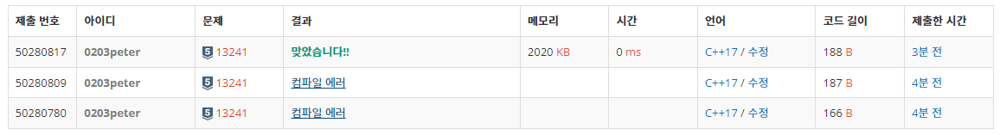

문제의 풀이가 말 그대로인 문제이다.



풀이

입력 a, b를 받았을 때 말 그대로 a와 b의 최소공배수를 출력해주는 문제이다.

a와 b의 최소공배수는 a \* b / (a와 b의 최대공약수)와 같다.

시간 복잡도 : $O(\\log (a+b))$

소요 시간 : 2분

아쉬운 점

원래 basic setup에서 코드 짧게 하겠다고 위에 쭉 지워서 제출했더니 컴파일 에러를 몇 번 받았다.

전체적인 감상

간만의 실버 5 기본 구현 문제였다. 간단하고 재밌다.

```cpp
#include<bits/stdc++.h>
using namespace std;
typedef long long ll;
ll a, b;
ll gcd(ll f, ll s){
	if(s == 0) return f;
	return gcd(s, f%s);
}
int main(){
	cin>>a>>b;
	cout<<a*b/gcd(a, b);
}
```
