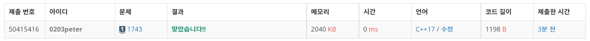

역시 시험기간에는 생각 없이 PS 하는 순간이 가장 즐겁다



풀이

이차원 bool 배열에 입력으로 들어오는 부분을 true로 바꾸어주고 이후 기본적인 bfs를 사용해 가장 큰 인접한 쓰레기들을 찾는다

\+ 풀고 나니 드는 생각인데 vis 배열과 ar 배열을 합쳐서 풀 수 있을 것 같다.

시간 복잡도 : $O(n\*m)$

소요 시간 : 3분

아쉬운 점 : class 6 문제 풀다가 어려워서 여기로 도망 왔다

전체적인 감상 : 처음 bfs 구현 연습할 때 풀기 좋은 문제인 것 같다.

```cpp
/* basic setup {{{ */
#include<bits/stdc++.h>
#define ff first
#define ss second
#define pb push_back
#define sz(x) ((int)x.size())
#define all(x) x.begin(),x.end()
#define compress(x) sort(all(x)), x.erase(unique(all(x)), x.end())
#define fast_io ios_base::sync_with_stdio(0),cin.tie(0),cout.tie(0)
using namespace std;
typedef long long ll;
typedef pair<int,int> pii;
typedef pair<ll,ll> pll;
typedef const int ci;
const int MOD = 1e9+7;
const int INF = 0x3f3f3f3f;
const ll LINF = 0x3f3f3f3f3f3f3f3f;
/*}}}*/
ci BN = 101;
bool ar[BN][BN], vis[BN][BN];
int n, m, k, ans, cnt, dx[] = {0, 0, -1, 1}, dy[] = {1, -1, 0, 0};
queue<pii> q;

int main(){
	fast_io;
	cin>>n>>m>>k;
	for(int i=0;i<k;i++){
		int a, b;
		cin>>a>>b;
		ar[a][b] = 1;
	}
	for(int i=1;i<=n;i++){
		for(int j=1;j<=m;j++){
			if(!vis[i][j] && ar[i][j]){
				q.push({i, j});
				vis[i][j] = 1;
				cnt = 1;
				while(!q.empty()){
					pii fr = q.front();
					q.pop();

					for(int p=0;p<4;p++){
						int cx = fr.ff + dx[p], cy = fr.ss + dy[p];
						if(!vis[cx][cy] && ar[cx][cy]){
							cnt++;
							q.push({cx, cy});
							vis[cx][cy] = 1;
						}
					}
				}
				ans = max(ans, cnt);
			}
		}
	}
	cout<<ans;
	cout<<'\n';
}
```
