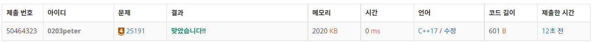

바쁘다 바빠



풀이

cout&lt;&lt;min(n, a/2+b);

시간 복잡도 : $O(1)$

소요 시간 : 30초

아쉬운 점 : 너무 쉽다

전체적인 감상 : 너무 바빠!!

```cpp
/* basic setup {{{ */
#include<bits/stdc++.h>
#define ff first
#define ss second
#define pb push_back
#define sz(x) ((int)x.size())
#define all(x) x.begin(),x.end()
#define compress(x) sort(all(x)), x.erase(unique(all(x)), x.end())
#define fast_io ios_base::sync_with_stdio(0),cin.tie(0),cout.tie(0)
using namespace std;
typedef long long ll;
typedef pair<int,int> pii;
typedef pair<ll,ll> pll;
typedef const int ci;
const int MOD = 1e9+7;
const int INF = 0x3f3f3f3f;
const ll LINF = 0x3f3f3f3f3f3f3f3f;
/*}}}*/

int main(){
	fast_io;
	int n, a, b;
	cin>>n>>a>>b;
	cout<<min(n, a/2+b);
	cout<<'\n';
}
```
