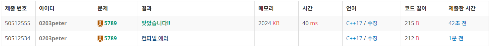

중간고사 준비 한다 안한다



풀이

문자열의 길이는 항상 짝수이다

가장 중앙의 두 char 이외의 다른 문자는 모두 필요 없다

두 문자가 다르다면 결국 Do-it-Not을 외칠 것이고

두 문자가 같다면 Do-it을 외칠 것이다.

시간 복잡도 : $O(1)$ (testcase 하나 당)

소요 시간 : 31초

아쉬운 점 : 너무 피곤하다

전체적인 감상 : 한다안한다한다안한다한다안한다한다안한다한다안한다한다안한다한다안한다

```cpp
#include<bits/stdc++.h>
using namespace std;
int main(){
	int n;
	cin>>n;
	string s1;
	for(int i=0;i<n;i++){
		cin>>s1;
		int s = s1.size()/2;
		cout<<"Do-it";
		if(s1[s-1] != s1[s]) cout<<"-Not";
		cout<<'\n';
	}
}
```
