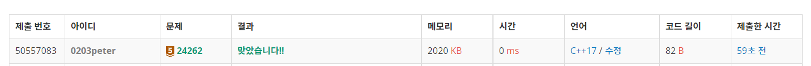

너무 바쁘다



풀이

input과 관계없이 항상 일정한 출력 값을 지닌다

시간 복잡도 : $O(1)$

소요 시간 : 측정 불가

아쉬운 점 : 없다

전체적인 감상 : 즐거운 청경채

```cpp
#include<bits/stdc++.h>
using namespace std;
int main(){
	cout<<1<<' '<<0<<'\n';
}
```
