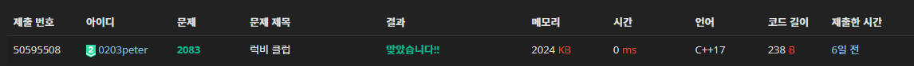

10/15일의 블로그이다.. 어제 카카오 데이터센터에 화재가 나 오늘 업로드하게 되었다..

[2083번: 럭비 클럽](https://www.acmicpc.net/problem/2083)




풀이  

문제에 나와있는 조건 두개를 구현해주면 100점을 받을 수 있다.


시간 복잡도 : $O(n)$  

소요 시간 : 30초  

아쉬운 점 : 중간고사 공부 어렵다  

전체적인 감상 : 오랜만에 bits/stdc++.h를 안쓰고 코드를 짰다.

```cpp
#include<bits/stdc++.h>
using namespace std;
int main(){
	while(1){
		string s1;
		int n, m;
		cin>>s1;
		cin>>n>>m;
		if(n == 0) return 0;
		cout<<s1<<' ';
		if(n > 17 || m >= 80) cout<<"Senior";
		else cout<<"Junior";
		cout<<'\n';
	}
}
```
