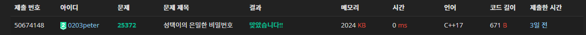

10/18일의 블로그이다

[25372번: 성택이의 은밀한 비밀번호](https://www.acmicpc.net/problem/25372)



풀이  

입력되는 문자열마다 그 길이가 문제에서 제시되는 범위 안으로 들어가는지 확인해주는 문제이다.  


시간 복잡도 : $O(n)$  

소요 시간 : 20초  

아쉬운 점 : 수학 공부 열심히 하자  

전체적인 감상 : 내일 시험은 수학이다  


```cpp
/* basic setup {{{ */
#include<bits/stdc++.h>
#define ff first
#define ss second
#define pb push_back
#define sz(x) ((int)x.size())
#define all(x) x.begin(),x.end()
#define compress(x) sort(all(x)), x.erase(unique(all(x)), x.end())
#define fast_io ios_base::sync_with_stdio(0),cin.tie(0),cout.tie(0)
using namespace std;
typedef long long ll;
typedef pair<int,int> pii;
typedef pair<ll,ll> pll;
typedef const int ci;
const int MOD = 1e9+7;
const int INF = 0x3f3f3f3f;
const ll LINF = 0x3f3f3f3f3f3f3f3f;
/*}}}*/

int main(){
   fast_io;
   int n;
   string s1;
   cin>>n;
   for(int i=0;i<n;i++){
      cin>>s1;
      if(sz(s1) >= 6 && sz(s1) <= 9) cout<<"yes\n";
      else cout<<"no\n";
   }
}
```
