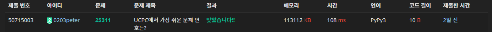

10/19일의 블로그이다

[25311번: UCPC에서 가장 쉬운 문제 번호는?](https://www.acmicpc.net/problem/25311)



풀이  

UCPC에서 가장 쉬운 문제 번호는 언제나 A이다 입력에 상관 없이 A를 출력해주면 된다.  

시간 복잡도 : $O(1)$  

소요 시간 : 10초  

아쉬운 점 : 국어 공부 열심히 하자  

전체적인 감상 : python 풀이, 내일 시험은 국어이다  


```python
print('A')
```
