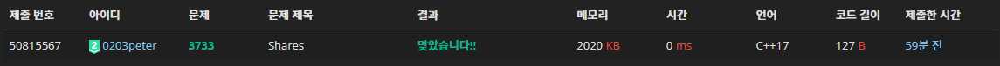

10/21일의 티스토리이다 내일부터는 다시 정상적인 날짜에 내 블로그가 올라갈 수 있기를 바란다.

[https://www.acmicpc.net/problem/3733](https://www.acmicpc.net/problem/3733)

[3733번: Shares](https://www.acmicpc.net/problem/3733)



풀이

입력으로 주어지는 두 쌍의 숫자들에 대해 정수 범위에서의 나눗셈을 해서 출력하면 된다 (s/(n+1))

시간 복잡도 : $O(1)$ 한 테케당

소요 시간 : 1분

아쉬운 점 : 피곤하다

전체적인 감상 : 2학기 1차 지필 고사가 끝난 날이다.

```cpp
#include<bits/stdc++.h>
using namespace std;

int l, r;

int main(){
    while(cin>>l>>r){
        cout<<r/(l+1)<<'\n';
    }
}
```
