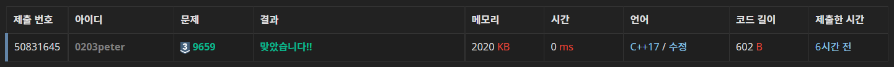

시험 기간이 완전히 끝나게 되었다. 깁브다

[https://www.acmicpc.net/problem/9659](https://www.acmicpc.net/problem/9659)

[9659번: 돌 게임 5](https://www.acmicpc.net/problem/9659)



풀이

돌을 가져갈 수 있는 방법은 1, 3 두 가지이다.

돌을 홀수 갯수로밖에 가져갈 수 없으므로 놓여있는 돌의 갯수가 홀수개이면 상근이가 짝수개이면 창영이가 게임을 이기게 된다.

시간 복잡도 : $O(1)$

아쉬운 점 : 더 어려운 문제도 많이 풀어야겠다

전체적인 감상 : 0203peter sprague-grundy theorem 공부하다 갑자기 프로돌게이머로 전향...

```cpp
/* basic setup {{{ */
#include<bits/stdc++.h>
#define ff first
#define ss second
#define pb push_back
#define sz(x) ((int)x.size())
#define all(x) x.begin(),x.end()
#define compress(x) sort(all(x)), x.erase(unique(all(x)), x.end())
#define fast_io ios_base::sync_with_stdio(0),cin.tie(0),cout.tie(0)
using namespace std;
typedef long long ll;
typedef pair<int,int> pii;
typedef pair<ll,ll> pll;
typedef const int ci;
const int MOD = 1e9+7;
const int INF = 0x3f3f3f3f;
const ll LINF = 0x3f3f3f3f3f3f3f3f;
/*}}}*/
ll n;
int main(){
	fast_io;
	cin>>n;
	if(n%2) cout<<"SK";
	else cout<<"CY";
	cout<<'\n';
}
```
