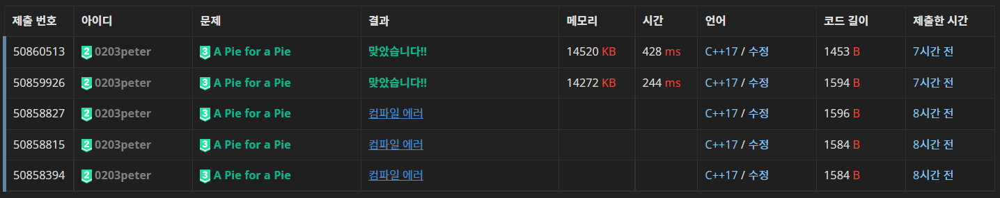

USACO가 또 다가온다

[https://www.acmicpc.net/problem/15457](https://www.acmicpc.net/problem/15457)

[15457번: A Pie for a Pie](https://www.acmicpc.net/problem/15457)



풀이

혼자 풀다 실패해서 usaco의 공식 solution을 참고하였다. [http://www.usaco.org/current/data/sol\_piepie\_gold\_dec17.html](http://www.usaco.org/current/data/sol_piepie_gold_dec17.html)

이 문제에서 물어보는 바는 파이 교환이 끝나는 지점으로 각각 상대가 느끼는 만족도가 0이 되는 파이가 이에 해당한다.

해당 문제를 해결해주기 위해 문제의 상황을 그래프 형태로 변환할 수 있다.

그래프에는 노드가 총 $2N$개 있다 해당 노드들은 Bessie의 Pie $N$개와 Elsie의 Pie $N$개로 구성된다.

이 중 Pie 교환을 끝내기에 적합한 파이들이 있다.

BFS를 하는데 해당 조건에 적합한 Pie들을 모두 시작 지점으로 하여 가능한 곳으로 옮겨가고 옮겨가면 최소 거리를 구할 수 있다. 모든 간선의 가중치가 1이기 때문에 이가 가능한 것이다.

결과는 그냥 dist 배열의 내용을 쭉 출력해주면 된다.

위 usaco 링크의 코드는 얼마나 효율적인지 궁금해서(bfs의 queue를 c++ stl이 아닌 배열과 변수 두개를 통해 구현해주는 모습을 볼 수 있다) 변형 없이 그대로 제출해 보았는데 당황스럽게도 그냥 편하게 queue 쓰는 게 약 2배 가까이 효율적이라는 것을 알게 되었다. (사람들이 많이 쓰는 데는 이유가 있구나...)

시간 복잡도 : $O(n \\log n)$

소요 시간 : 측정 불가

아쉬운 점

플래티넘 문제도 어렵지 않게 풀고 싶다

전체적인 감상

해당 문제와 관련한 기법을 소개하는 글도 있는 것 같다. 흥미롭게 읽어볼 수 있을 것 같아 주소를 남긴다. [https://codeforces.com/blog/entry/93652](https://codeforces.com/blog/entry/93652)

```cpp
/* basic setup {{{ */
#include<bits/stdc++.h>
#define ff first
#define ss second
#define pb push_back
#define sz(x) ((int)x.size())
#define all(x) x.begin(),x.end()
#define compress(x) sort(all(x)), x.erase(unique(all(x)), x.end())
#define fast_io ios_base::sync_with_stdio(0),cin.tie(0),cout.tie(0)
using namespace std;
typedef long long ll;
typedef pair<int,int> pii;
typedef pair<ll,ll> pll;
typedef const int ci;
const int MOD = 1e9+7;
const int INF = 0x3f3f3f3f;
const ll LINF = 0x3f3f3f3f3f3f3f3f;
/*}}}*/
ci BN = 100010;
int n, d, a[BN*2], b[BN*2], dis[BN*2];
queue<int> q;

struct cmpA{
	bool operator()(int l, int r)const{
		return b[l]<b[r];
	}
};
struct cmpB{
	bool operator()(int l, int r)const{
		return a[l]<a[r];
	}
};

multiset<int,cmpA> msa;
multiset<int,cmpB> msb;

int main(){
	fast_io;
	cin>>n>>d;
	for(int i=0;i<2*n;i++){
		cin>>a[i]>>b[i];
		a[i] = -a[i];
		b[i] = -b[i];
		dis[i] = -1;
	}
	for(int i=0;i<n;i++){
		if(b[i] == 0) q.push(i), dis[i] = 1;
		else msa.insert(i);
		if(a[i+n] == 0) q.push(i+n), dis[i+n] = 1;
		else msb.insert(i+n);
	}
	multiset<int,cmpA>::iterator itA;
	multiset<int,cmpB>::iterator itB;

	while(!q.empty()){
		int i = q.front();
		q.pop();
		if(i < n){
			while(1){
				itB = msb.lower_bound(i);
				if(itB == msb.end()||a[*itB] > a[i]+d) break;
				dis[*itB] = dis[i] + 1;
				q.push(*itB);
				msb.erase(itB);
			}
		}
		else{
			while(1){
				itA = msa.lower_bound(i);
				if(itA == msa.end()||b[*itA] > b[i]+d) break;
				dis[*itA] = dis[i] + 1;
				q.push(*itA);
				msa.erase(itA);
			}
		}
	}
	for(int i=0;i<n;i++) cout<<dis[i]<<'\n';
}
```
