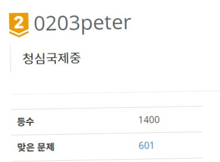

*솔직히 600문제에 골드 2 마크는 조금 부끄럽긴 하네*

오늘 드디어 푼 문제수 600개를 넘겨 기록을 남깁니다

PS를 C++을 통해 올해 4월쯤에 본격적으로 시작하게 되며 2021년 11월 20일 결국 600문제를 넘기고야 말았습니다

이 600이라는 숫자에 도달하는데까지 그 과정에 있어 다양한 점들을 알게 되었고

이번 글에서는 이에 대해 말하고자 합니다

600문제에 쉬운 문제들이 너무 많이 포함되어있어 이걸 이렇게 당당히 말하기에는 약간 민망한 느낌이 있지만

고수분들은 얘는 이런 생각을 했구나\~ 하고 귀엽게 봐주시고 이 분야를 처음 접하시는 분들은 이 글을 읽고 흥미를 느껴보셨음 좋겠습니다.

그럼 제가 PS공부를 시작하고 여기까지 오는 그 과정에 대해 짧게 말씀드려보겠습니다.

2020년 말부터 2021년 초까지 알고리즘을 가르치는 학원에서 C++을 통해 PS에 입문하게 되었습니다.

학원에서 준비했던 것들을 바탕으로 5월쯤에 열렸던 한국정보올림피아드에 참가했어요. 당시 누적합, 이분탐색, 그래프와 같은 기본 알고리즘도 잘 모르던 저는 역시 대회 1차 예선에서 장려상 받고 탈락하게 되었습니다. 이 이후로 제 실력에 많은 문제를 느껴 알고리즘을 섭렵하고자 하는 강한 열망을 느꼈어요. 이후로 인터넷에서 PS 학습에 대한 다양한 팁들을 찾아보며 열심히 공부해 나아가고 있었습니다. 그러던 중 IOI, USACO, ACSL 등등 다양한 대회에 대해 더 관심이 많아지고 이러한 대회들에서 지금까지 공부한 것을 사용해보자 라는 생각을 많이 하게 되었는데. 마침 8월이 되었고 NYPC 예선이 시작되었습니다. 코로나 때문에 학교도 안가는데 일주일동안 다른거 안하고 NYPC 문제만 풀어보자! 라는 생각으로 예선 문제를 치르며 결국 1080/1500 점 정도의, 저에게는 만족스러운 결과를 얻어가게 되었어요. 이 이후로는 제가 모르는 알고리즘들 하나하나 공부해 나가며 성장하고 있습니다. 요즘에는 올해 12월부터 시작되는 USACO Silver 달성을 목표로 공부하고 있는데 역시나 이 과정이 쉽지만은 않은 것 같습니다.

이렇게 장황한 경험담 속에서도 제가 가장 강조드리고 싶은 부분은

<b>지금 당장 새로운 알고리즘에 도전하고 내일도 이를 이어가라</b> 입니다.

저도 이것을 완벽하게 지키고 있지는 않지만 이 목표에 가까워짐으로서 점점 성장해가고 있음을 느낍니다.

두서없는 글 열심히 읽어주셔서 감사합니다!

궁금한 점(있으려나?) 있으시다면 댓글 남겨주세요
