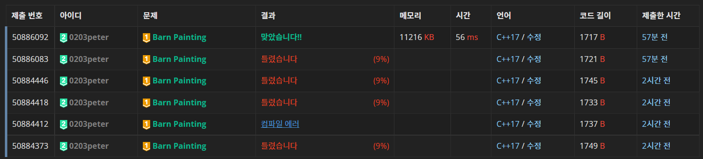

USACO Gold 2번 문제이다. Tree dp를 연습하기에 좋은 문제라고 생각한다. 나도 잘 연습되었다.

[https://www.acmicpc.net/problem/15458](https://www.acmicpc.net/problem/15458)

[15458번: Barn Painting](https://www.acmicpc.net/problem/15458)



풀이

가장 핵심이 되는 부분은 기본 세팅을 해준 후 재귀 dp 함수를 작성하여 주는 것이다.

모순이 되는 경우 return 0을 해주고 상황이 맞는 경우 자식으로 가는 가능성들을 모두 곱해주는 것이다. 이 것이 문제의 해답이 된다. 기본적인 구조이기 때문에 주석과 함께 코드를 읽고 이해해보기를 추천한다.

시간 복잡도 : $O(N)$

소요 시간 : 측정 불가

아쉬운 점 : 트리 dp 짜는 게 수월하지 않았다.

전체적인 감상 : usaco문제만을 집중적으로 풀 시기가 온 것 같다.

```cpp
/* basic setup {{{ */
#include<bits/stdc++.h>
#define ff first
#define ss second
#define pb push_back
#define sz(x) ((int)x.size())
#define all(x) x.begin(),x.end()
#define compress(x) sort(all(x)), x.erase(unique(all(x)), x.end())
#define fast_io ios_base::sync_with_stdio(0),cin.tie(0),cout.tie(0)
using namespace std;
typedef long long ll;
typedef pair<int,int> pii;
typedef pair<ll,ll> pll;
typedef const int ci;
const ll MOD = 1e9+7;
const int INF = 0x3f3f3f3f;
const ll LINF = 0x3f3f3f3f3f3f3f3f;
/*}}}*/
ci BN = 1e5+10;
ll n, k, a, b, clrd[BN];
ll dp[BN][3];
vector<int> adj[BN];

// 자신의 자식을 확인해주기 위해 parent를 따로 저장해줌(v node # and color)
ll dfs(int nowv, int nowc, int bfv, int bfc){
	// current node and current color
	if(nowc == bfc || (clrd[nowv] >= 0 && nowc != clrd[nowv])) return 0;
	// 부모와 현재의 색이 같다면 or 처음에 배정받은 색이 있으며 cur color가 그 색과 다를때(모순)
	if(dp[nowv][nowc] >= 0) {
		// 이미 해당 dp를 채운적이 있다면
		return dp[nowv][nowc];
	}

	dp[nowv][nowc] = 1;
	// -1을 1로 세팅
	for(int nxt : adj[nowv]) {
		if(nxt == bfv) continue;
		// 부모일 경우에는 pass

		ll brch = 0;
		for(int c=0;c<3;c++){
			brch += dfs(nxt, c, nowv, nowc); // 세 가지 가능성을 모두 더함
			brch %= MOD;
		}
		dp[nowv][nowc] *= brch;
		dp[nowv][nowc] %= MOD;
	}
	return dp[nowv][nowc];
}

int main(){
	fast_io;
	memset(clrd, -1, sizeof clrd);
	memset(dp, -1, sizeof dp);

	cin>>n>>k;
	for(int i=0;i<n-1;i++){
		cin>>a>>b;
		adj[--a].pb(--b);
		adj[b].pb(a);
	}
	for(int i=0;i<k;i++){
		cin>>a>>b;
		clrd[--a] = --b;
	}
	cout<<(dfs(0, 0, -1, -1) + dfs(0, 1, -1, -1) + dfs(0, 2, -1, -1))%MOD;
}
```
