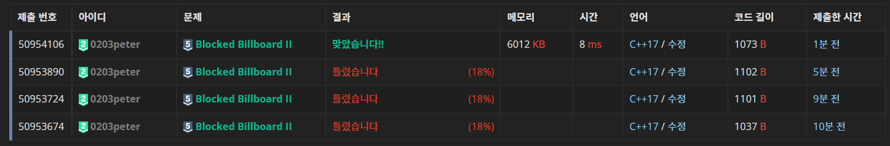

더 어려운 문제를 풀다 할 일이 너무 많아 갑자기 코딩이 너무 하기 싫어져 같은 시즌의 bronze 문제를 풀었다.

[https://www.acmicpc.net/problem/15592](https://www.acmicpc.net/problem/15592)

[15592번: Blocked Billboard II](https://www.acmicpc.net/problem/15592)



풀이

순서쌍 8개를 입력받고 bool 배열에 문제 내용을 직접 표시해준다. 표시를 없애주는 내용도 마찬가지이다.

체크해준 배열의 가장 작은 x, y와 가장 큰 x, y를 구하여 (x-x+1)\*(y-y+1)을 해주어 답을 구한다.

시간 복잡도 : $O(2000^2)$

소요 시간 : 13분

아쉬운 점 : 문제의 좌표를 정확하게 이해하지 못해 반례를 직접 만들고 나서야 정답을 받을 수 있었다.

전체적인 감상 : 앞으로 더욱 열심히 해야겠음을 느낀다.

```cpp
/* basic setup {{{ */
#include<bits/stdc++.h>
#define ff first
#define ss second
#define pb push_back
#define sz(x) ((int)x.size())
#define all(x) x.begin(),x.end()
#define compress(x) sort(all(x)), x.erase(unique(all(x)), x.end())
#define fast_io ios_base::sync_with_stdio(0),cin.tie(0),cout.tie(0)
using namespace std;
typedef long long ll;
typedef pair<int,int> pii;
typedef pair<ll,ll> pll;
typedef const int ci;
const int MOD = 1e9+7;
const int INF = 0x3f3f3f3f;
const ll LINF = 0x3f3f3f3f3f3f3f3f;
/*}}}*/
ci BN = 2022;
int lx=INF,ly=INF,rx=-1,ry=-1;
bool mappe[BN][BN];
int a, b, c, d;
int e, f, g, h;

int main(){
	fast_io;
	cin>>a>>b>>c>>d;
	cin>>e>>f>>g>>h;
	for(int i=a;i<c;i++){
		for(int j=b;j<d;j++){
			mappe[i+1000][j+1000] = 1;
		}
	}
	for(int i=e;i<g;i++){
		for(int j=f;j<h;j++){
			mappe[i+1000][j+1000] = 0;
		}
	}

	for(int i=0;i<BN;i++){
		for(int j=0;j<BN;j++){
			if(mappe[i][j]){
				lx = min(lx, i);
				rx = max(rx, i);

				ly = min(ly, j);
				ry = max(ry, j);
			}
		}
	}
	if(rx != -1) cout<<(ry-ly+1)*(rx-lx+1);
	else cout<<0;
	cout<<'\n';
}
```
