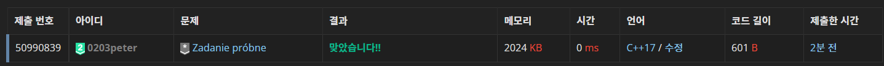

요즘 좀 힘들다

[https://www.acmicpc.net/problem/8545](https://www.acmicpc.net/problem/8545)

[8545번: Zadanie próbne](https://www.acmicpc.net/problem/8545)



풀이

문자열을 입력받고 반대로 뒤집어 출력해주면 되는 문제이다.

시간 복잡도 : $O(N)$

소요 시간 : 800일

아쉬운 점 : 없다

전체적인 감상 : 아쉽다.

```cpp
/* basic setup {{{ */
#include<bits/stdc++.h>
#define ff first
#define ss second
#define pb push_back
#define sz(x) ((int)x.size())
#define all(x) x.begin(),x.end()
#define compress(x) sort(all(x)), x.erase(unique(all(x)), x.end())
#define fast_io ios_base::sync_with_stdio(0),cin.tie(0),cout.tie(0)
using namespace std;
typedef long long ll;
typedef pair<int,int> pii;
typedef pair<ll,ll> pll;
typedef const int ci;
const int MOD = 1e9+7;
const int INF = 0x3f3f3f3f;
const ll LINF = 0x3f3f3f3f3f3f3f3f;
/*}}}*/

int main(){
	fast_io;
	string s1;
	cin>>s1;
	reverse(all(s1));
	cout<<s1;
	cout<<'\n';
}
```
