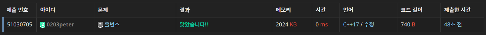

기본 문제

[https://www.acmicpc.net/problem/4470](https://www.acmicpc.net/problem/4470)

[4470번: 줄번호](https://www.acmicpc.net/problem/4470)



풀이

n개의 줄바꿈 단위의 문자를 입력받아 앞에 숫자를 붙여 출력하는 문제이다

시간 복잡도 : $O(N)$

소요 시간 : 1분

아쉬운 점 : 없다

전체적인 감상 : 행복하다 ^^

```cpp
/* basic setup {{{ */
#include<bits/stdc++.h>
#define ff first
#define ss second
#define pb push_back
#define sz(x) ((int)x.size())
#define all(x) x.begin(),x.end()
#define compress(x) sort(all(x)), x.erase(unique(all(x)), x.end())
#define fast_io ios_base::sync_with_stdio(0),cin.tie(0),cout.tie(0)
using namespace std;
typedef long long ll;
typedef pair<int,int> pii;
typedef pair<ll,ll> pll;
typedef const int ci;
const int MOD = 1e9+7;
const int INF = 0x3f3f3f3f;
const ll LINF = 0x3f3f3f3f3f3f3f3f;
/*}}}*/

int main(){
	fast_io;
	string s1;
	int n;
	cin>>n;
	getline(cin, s1);
	vector<string> vc;
	for(int i=0;i<n;i++){
		getline(cin, s1);
		vc.pb(s1);
	}
	int i = 1;
	for(string s : vc){
		cout<<i++<<". "<<s<<'\n';
	}
	cout<<'\n';
}
/* basic setup {{{ */
#include<bits/stdc++.h>
#define ff first
#define ss second
#define pb push_back
#define sz(x) ((int)x.size())
#define all(x) x.begin(),x.end()
#define compress(x) sort(all(x)), x.erase(unique(all(x)), x.end())
#define fast_io ios_base::sync_with_stdio(0),cin.tie(0),cout.tie(0)
using namespace std;
typedef long long ll;
typedef pair<int,int> pii;
typedef pair<ll,ll> pll;
typedef const int ci;
const int MOD = 1e9+7;
const int INF = 0x3f3f3f3f;
const ll LINF = 0x3f3f3f3f3f3f3f3f;
/*}}}*/

int main(){
	fast_io;
	string s1;
	int n;
	cin>>n;
	getline(cin, s1);
	vector<string> vc;
	for(int i=0;i<n;i++){
		getline(cin, s1);
		vc.pb(s1);
	}
	int i = 1;
	for(string s : vc){
		cout<<i++<<". "<<s<<'\n';
	}
	cout<<'\n';
}
```
