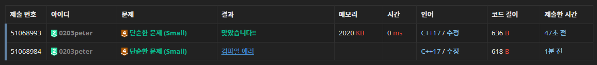

정말 단순한 문제이다

[https://www.acmicpc.net/problem/25494](https://www.acmicpc.net/problem/25494)

[25494번: 단순한 문제 (Small)](https://www.acmicpc.net/problem/25494)



풀이

세 입력 중 그냥 최소값 출력해주면 된다

시간 복잡도 $O(N)$

소요 시간 : 30초

아쉬운 점 : 없다

전체적인 감상 : 쉽다

```cpp
/* basic setup {{{ */
#include<bits/stdc++.h>
#define ff first
#define ss second
#define pb push_back
#define sz(x) ((int)x.size())
#define all(x) x.begin(),x.end()
#define compress(x) sort(all(x)), x.erase(unique(all(x)), x.end())
#define fast_io ios_base::sync_with_stdio(0),cin.tie(0),cout.tie(0)
using namespace std;
typedef long long ll;
typedef pair<int,int> pii;
typedef pair<ll,ll> pll;
typedef const int ci;
const int MOD = 1e9+7;
const int INF = 0x3f3f3f3f;
const ll LINF = 0x3f3f3f3f3f3f3f3f;
/*}}}*/

int main(){
	fast_io;
	int n, a, b, c;
	cin>>n;
	while(n--){
		cin>>a>>b>>c;
		cout<<min({a,b,c})<<'\n';
	}
	cout<<'\n';
}
```
